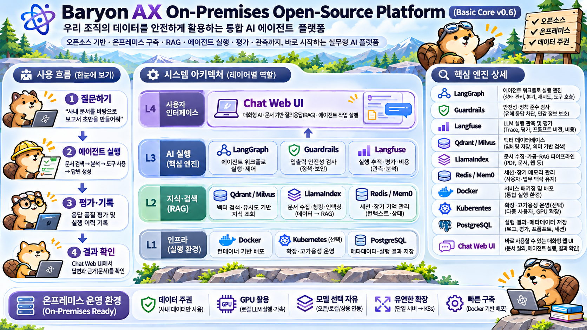
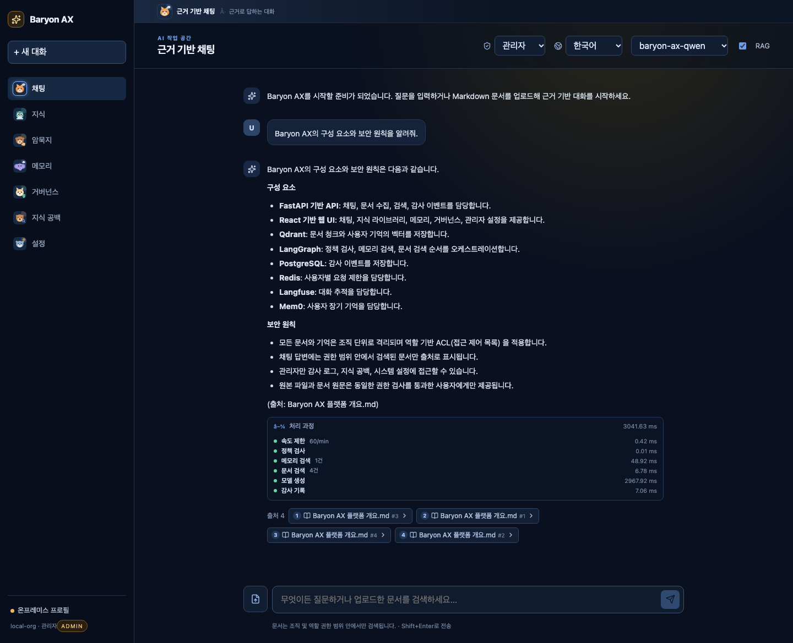

# Baryon AX

**Baryon AX** is an on-premises, model-agnostic foundation for enterprise AI agents and grounded chat.

> Connect models. Orchestrate agents. Ground knowledge. Observe everything.

This repository is an executable Basic Core v0.6 reference implementation. It offers a complete vertical slice: role-aware chat, OpenAI-compatible model routing, document ingestion and vector retrieval with citations, policy checks, audit events, memory, and a browser UI. The Basic Core runs with a local demo model and file storage; the **full-stack profile** connects Ollama, Qdrant, PostgreSQL, Redis, Langfuse, LangGraph, LlamaIndex, and Mem0. See [docs/full-stack.md](docs/full-stack.md) for the applied stack.

## Platform at a glance



<p align="center">
  
  
  
  
  
  
  
</p>

The platform brings a chat workspace, agent execution, grounded knowledge search, and on-premises infrastructure into one operating model. The image summarizes the user flow—ask, run an agent, evaluate, and review evidence—and the responsibilities of each layer. It is the **target production architecture**; the Basic Core maps most of it to in-process adapters, and the full-stack profile connects the stateful services. See [docs/architecture.md](docs/architecture.md#compose-vs-target-architecture) for the component-by-component mapping.

## Screenshots

<a href="docs/screenshots.md"></a>

Eight captured screens cover grounded chat, the source viewer, knowledge upload, memory, tacit-knowledge provenance, governance, knowledge gaps, and admin system metrics. See [docs/screenshots.md](docs/screenshots.md).

## What works today

- Chat UI with model selection, token streaming, and Markdown rendering (GFM)
- Keyboard-first composer: `Shift+Enter` sends, `Enter` starts a new line
- Korean-first bilingual UI (한국어 / English), with browser-language detection and persisted preference
- OpenAI-compatible model adapter, verified with **Ollama `qwen2.5:7b`** and **vLLM `Qwen3.5-27B` on B300 GPU 7**, with a safe local demo fallback
- Input/output policy checks and basic PII masking, including chunk-boundary-safe streaming masks
- Knowledge screen with a drag-and-drop upload zone and per-format badges (PDF, HWP, HWPX, Office, images, text)
- Durable document upload with **MIME-based parser routing** (HWP/HWPX/PDF/Office/images via kordoc/docling/Tika sidecars), **structure-aware chunking** (heading paths, table headers), **Qdrant vector retrieval** with lexical fallback, and source citations
- **LangGraph** policy/retrieval orchestration, **FastEmbed** multilingual embeddings
- Role-aware document ACLs, inline administrator editing, and organization isolation
- **Tacit knowledge capture**: question-and-answer sessions (from open gaps or curated prompts) with file attachments; publishing an answer indexes it as searchable knowledge
- **Knowledge-gap capture**: ungrounded or vague answers are clustered into admin-reviewed **ontology pack drafts** (entities, relations, required sources)
- **PostgreSQL audit events** with JSONL mirroring, **Redis rate limiting**, and **Langfuse tracing**
- **Mem0 user memory** with Qdrant + Ollama, managed from a dedicated UI tab and **injected into chat answers**
- **Pipeline trace** under each answer: rate limit, policy, memory search, document search, model, and audit steps with timings
- **Citation viewer**: click a source to see the cited passage, the full text, and the original uploaded file
- Administrator settings with runtime, policy, storage, integration, and activity overview
- Live system cards for storage, memory, CPU load, process count, Compose containers, and backend health
- One-click admin links for Qdrant, Langfuse, the model server, pgAdmin, and Redis Insight, plus per-integration docs
- Docker Compose Basic Core profile and a **full-stack override** (`docker-compose.full.yml`)
- **B300 host deployment**: platform, Langfuse, Mem0, Qdrant, PostgreSQL, and Redis on the B300 server, using GPU 7 vLLM
- Kubernetes starter manifests and deployment profiles

## 암묵지 지식화 사이클 (Tacit → Explicit)

문서에 없는 판단 기준, 예외 처리, 사내 용어, 장애 대응 노하우를 **질문 → 답변 → 게시 → 검증 → 활용** 루프로 문서화합니다. 핵심은 "사람이 아는 것을 문서로 옮기는 일"을 일회성 인터뷰가 아니라 **운영되는 사이클**로 만드는 것입니다.

```text
[1] 감지                 [2] 질문                 [3] 답변
채팅이 근거를 찾지 못함 ──> 지식 공백 기록 ──> 공백 우선 질문 + 템플릿
모호하거나 자신 없는 답변      (질문·이유·발생횟수)      전문가가 경험과 이유를 작성
        │                        │                        │
        │                        └── 기존 문서 첨부 ◀──────┘
        ▼                                                 ▼
[6] 환류                 [5] 검증                 [4] 지식화
다음 질문 큐로 재투입 ◀── 공백 해소 여부 확인 ◀── 게시: Markdown 문서 생성
새 공백이 쌓이면 반복          팩 커버리지 재검증          파싱·청킹·임베딩·Qdrant 색인
                                                          │
                                                          ▼
                                                   채팅 검색 근거 + 출처로 사용
```

### 단계별 동작

| 단계 | 하는 일 | 구현 |
| --- | --- | --- |
| **1. 감지** | 인용이 없거나 모호한 답변을 지식 공백으로 기록하고, 질문·이유·발생 횟수를 누적합니다. | `record_knowledge_gap`, `GapStore`, `/v1/admin/gaps` |
| **2. 질문** | 열린 공백을 최우선으로 질문 큐에 올리고, 부족하면 5개 템플릿(판단 기준·온보딩·권한/예외·용어·문제 해결)으로 보완합니다. | `suggest_questions`, `GET /v1/tacit/questions` |
| **3. 답변** | 담당자가 결론만이 아니라 **이유와 예외 조건**을 작성합니다. 기존 문서를 첨부해 맥락을 보강할 수 있습니다. 초안은 작성자 또는 관리자만 수정합니다. | `TacitStore`, `POST/PATCH /v1/tacit/entries` |
| **4. 지식화** | 게시하면 `# 암묵지: {질문}` 형식의 Markdown 문서가 생성되고, 일반 업로드와 **동일한 파이프라인**(파싱·청킹·임베딩·Qdrant)을 거쳐 검색 가능한 지식이 됩니다. | `POST /v1/tacit/entries/{id}/publish`, `ingest_upload` |
| **5. 검증** | 게시된 답변이 원래 공백을 해소했는지 확인하고, 연결된 공백을 닫습니다. 온톨로지 팩이 있으면 수용 질문으로 커버리지를 재검증합니다. | `knowledge.gap_resolved`, `verify_pack` |
| **6. 활용·환류** | 게시된 문서는 다음 채팅부터 출처와 함께 사용됩니다. 해결되지 않은 공백은 다시 질문 큐로 돌아가 사이클이 반복됩니다. | 채팅 검색, `GET /v1/tacit/entries` |

### 운영 원칙

- **결론보다 판단 근거를 적습니다.** "예외는 팀장 승인"보다 "왜, 어느 범위까지, 어떤 경우에"를 남겨야 재사용됩니다.
- **한 번에 하나의 질문**에 답합니다. 질문을 쪼개면 검색 청크가 작아지고 인용 정확도가 올라갑니다.
- **공백에서 시작합니다.** 템플릿보다 실제로 답변에 실패한 질문이 신호가 큽니다.
- **게시 전 검토합니다.** 게시된 답변은 수정할 수 없으므로 초안 단계에서 작성자·관리자가 확인합니다.
- **권한을 유지합니다.** 답변과 첨부는 조직·역할 ACL을 따르고, 게시 문서는 `member`/`admin` 역할에 공개됩니다.
- 모든 기록과 게시는 `tacit.recorded`, `tacit.published`, `knowledge.gap_resolved` 감사 이벤트로 남습니다.

UI에서는 **암묵지** 탭에서 질문 큐, 내 답변, 전체 답변, 게시 상태를 확인할 수 있습니다. 각 항목의 **생성 근거**를 펼치면 생성 경로(공백/템플릿/직접 작성), 원본 질문, 감지 사유, 발생 횟수, 핵심 용어, 게시된 문서까지 확인할 수 있습니다. 지식 공백과 암묵지 저장소는 `/data/gaps`, `/data/tacit`에 보관되어 재시작 후에도 유지됩니다.

## Quick start

> **하드웨어 최소사양**: Basic Core, Full stack, GPU 추론 구성별 CPU·RAM·GPU·스토리지 기준은 [docs/hardware-requirements.md](docs/hardware-requirements.md)에 정리되어 있습니다.

### Basic Core (no external services)

```bash
cp .env.example .env
docker compose up --build
```

Open `http://localhost:3001`. The default `demo-local` model works without an API key.

To use a real model from the container stack, expose the host's loopback Ollama (it binds `127.0.0.1` by default) and let Compose reach it:

```bash
python3 scripts/ollama_proxy.py --listen-port 11435 &   # host -> 127.0.0.1:11434
docker compose -f docker-compose.yml -f docker-compose.parsers.yml --profile parsers up -d api
```

Compose reads `MODEL_BASE_URL_DOCKER` (default `http://host.docker.internal:11435/v1`) and `MODEL_NAME` (default `qwen2.5:7b`). `/health` reports `model_adapter: openai-compatible` when connected. For remote vLLM, point `MODEL_BASE_URL_DOCKER` at the tunnel and set `MODEL_NAME` accordingly.

To accept HWP/HWPX/PDF/Office/images, add the parser sidecars:

```bash
docker compose -f docker-compose.yml -f docker-compose.parsers.yml --profile parsers up -d --build
```

### Full stack (Ollama + Qdrant + PostgreSQL + Redis + Langfuse + Mem0)

```bash
# Docker Desktop에서 Ollama(127.0.0.1)를 노출하는 프록시
python3 scripts/ollama_proxy.py --listen-port 11435 &

OLLAMA_HOST_URL=http://host.docker.internal:11435 \
  docker compose -f docker-compose.yml -f docker-compose.full.yml \
  --profile deps up -d --build
```

- UI: `http://localhost:3001` (Langfuse가 3000을 사용)
- API: `http://localhost:8000`
- 자세한 준비·검증·문제 해결: [docs/full-stack.md](docs/full-stack.md)

| Variable | Default | Purpose |
| --- | --- | --- |
| `MODEL_BASE_URL` | empty | OpenAI-compatible endpoint; empty selects `demo-local` |
| `MODEL_NAME` | `qwen2.5:7b` | Model ID (full stack) |
| `MODEL_DISABLE_THINKING` | `false` | Send `enable_thinking=false` for Qwen3.5/vLLM |
| `MODEL_PROMPT_PROFILE` | `auto` | Model-specific grounded system prompt (`qwen35`, `qwen`, `generic`) |
| `RETRIEVAL_MIN_SCORE` | `0.3` | Minimum Qdrant similarity for a citation |
| `MODEL_TIMEOUT_SECONDS` | `180` | Upstream connect/read timeout |
| `DATABASE_URL` | empty | PostgreSQL audit store (empty = JSONL only) |
| `REDIS_URL` | empty | Redis rate limiter (empty = disabled) |
| `QDRANT_URL` | empty | Qdrant vector store (empty = lexical fallback) |
| `EMBEDDING_MODEL` | multilingual MiniLM | FastEmbed model |
| `LANGFUSE_ENABLED` / `LANGFUSE_HOST` | `false` / local | Langfuse tracing |
| `MEM0_ENABLED` / `OLLAMA_BASE_URL` | `false` / local | Mem0 memory layer |
| `DOCUMENT_STORE` | `/tmp/baryon-ax-documents` | Durable document JSON directory |
| `AUDIT_LOG` | `/tmp/baryon-ax-audit/events.jsonl` | JSONL audit mirror |
| `MAX_DOCUMENT_BYTES` | `20000000` | Upload size limit |
| `KORDOC_URL` / `KORDOC_CMD` | empty | kordoc sidecar (`POST /parse`) or CLI (`--format json`) for HWP/HWPX |
| `DOCLING_URL` / `DOCLING_CMD` | empty | docling sidecar or CLI for PDF/Office/images |
| `TIKA_URL` | empty | Tika `PUT /tika` fallback for legacy formats |
| `PARSER_TIMEOUT_SECONDS` | `180` | Per-document parser timeout |
| `INGEST_BATCH_SIZE` / `INGEST_MAX_IN_FLIGHT` | `8` / `4` | Ingest pipeline batching and concurrency |
| `RATE_LIMIT_PER_MINUTE` | `60` | Chat requests per user/org per minute |

## Architecture

```text
Browser UI ──> FastAPI gateway ──> LangGraph policy/retrieval ──> model adapter ──> response stream
                        │                    │                          │
                        │                    ├──> Qdrant + FastEmbed ───┤
                        │                    └──> Mem0 (Qdrant/Ollama)  │
                        ├──> PostgreSQL audit / JSONL mirror
                        ├──> Redis rate limiter
                        └──> Langfuse traces
```

See [docs/full-stack.md](docs/full-stack.md) for the applied stack, [docs/b300-vllm.md](docs/b300-vllm.md) for the remote B300 GPU 7 vLLM test, [docs/b300-host-deploy.md](docs/b300-host-deploy.md) for the full platform on B300, [docs/research/strata-and-local-ai-shortlist.md](docs/research/strata-and-local-ai-shortlist.md) for the Strata/local-AI research, [docs/research/clawfit-positioning.md](docs/research/clawfit-positioning.md) for the clawfit comparison and registration strategy, [docs/research/knowledge-gap-loop.md](docs/research/knowledge-gap-loop.md) for the knowledge-gap and ontology loop, [docs/research/clawfit/](docs/research/clawfit/) for the clawfit research-watch draft and registry entry proposal, [docs/features.md](docs/features.md) for the complete feature inventory, [docs/open-source.md](docs/open-source.md) for the open-source component and license inventory, and [docs/architecture.md](docs/architecture.md), [docs/operations.md](docs/operations.md), and [docs/security.md](docs/security.md) for the intended production integration boundaries. Ingestion design lives in [docs/ingestion/architecture.md](docs/ingestion/architecture.md) and the parser/connector survey in [docs/ingestion/open-source-inventory.md](docs/ingestion/open-source-inventory.md).

## API highlights

| Endpoint | Purpose |
| --- | --- |
| `GET /health` | Liveness and configured adapter status |
| `GET /v1/models` | Models visible to the caller |
| `POST /v1/chat/completions` | OpenAI-style chat completion, including SSE streaming |
| `POST /v1/documents` | Upload a document (MIME-routed; `?async=true` returns a job id) |
| `GET /v1/jobs/{job_id}` | Async ingest job state and chunk count |
| `GET /v1/documents` | List documents visible to the caller (`?category=&tag=` filters) |
| `GET /v1/documents/{id}` | Permission-checked document text and cited chunk (`?chunk=N`) |
| `GET /v1/documents/{id}/file` | Original uploaded file for authorized viewers |
| `DELETE /v1/documents/{id}` | Delete a document as its uploader or an administrator |
| `PATCH /v1/documents/{id}` | Update category/tags (uploader or admin) and role ACL (admin) |
| `GET /v1/documents/search` | Permission-scoped retrieval results |
| `POST /v1/memories` | Store a user memory with Mem0 |
| `GET /v1/memories` | List the caller's memories |
| `GET /v1/memories/search` | Semantic memory search |
| `DELETE /v1/memories/{id}` | Delete the caller's memory |
| `GET /v1/audit-events` | Recent audit events for administrators |
| `GET /v1/tacit/questions` | Suggested questions from open gaps and templates |
| `POST /v1/tacit/entries` | Save an answer with attachment document ids |
| `POST /v1/tacit/entries/{id}/publish` | Index the answer as a searchable document |
| `GET /v1/admin/gaps` | Ungrounded questions with reasons and occurrence counts (admin) |
| `GET /v1/admin/gaps/clusters` | Proposed ontology clusters (admin) |
| `POST /v1/admin/ontology-packs` | Create a draft ontology pack from selected gaps (admin) |
| `GET /v1/admin/ontology-packs` | List draft ontology packs (admin) |
| `POST /v1/admin/reindex` | Reindex documents into Qdrant (administrator) |
| `GET /v1/admin/settings` | Effective runtime, storage, policy, and integration settings for administrators |

For local development, callers can send `X-User-Id`, `X-Organization-Id`, and `X-Roles` headers. Replace this development identity adapter with OIDC/SSO before production use.

## Repository layout

```text
apps/api/       FastAPI control plane and API
apps/web/       React + Vite chat UI
deploy/         Compose and Kubernetes deployment assets
docs/           Architecture, operations, security, full-stack, B300 deployment, research, inventory
scripts/        Ollama proxy, B300 vLLM serve/tunnel, full-stack smoke
```

## Development

```bash
cd apps/api && python3.12 -m venv .venv && source .venv/bin/activate
pip install -e '.[dev]'
pytest

cd ../web
npm install
npm run build
```

API를 호스트에서 실행할 때 `.env`를 명시적으로 로드합니다.

```bash
uvicorn baryon.main:app --app-dir apps/api/src --host 127.0.0.1 --port 8000 --env-file .env
```

### End-to-end test

Start the API on port 8000 and the web dev server on port 5173, then:

```bash
cd apps/web
npx playwright install chromium   # first run only
npm run test:e2e
```

Set `E2E_BASE_URL` to test another deployment (for example `http://127.0.0.1:3001` for the Compose web service), and `E2E_SCREENSHOT=/tmp/baryon-ax.png` to capture a full-page screenshot.

### Full-stack smoke

```bash
API_BASE=http://127.0.0.1:8000 REQUIRE_FULL=1 python3 scripts/smoke_full_stack.py
```

The smoke check covers health backends, document upload, Qdrant retrieval, chat, audit, and Mem0 memory.

## Security status

This is a reference implementation, not a security certification. The development identity headers, local JSON files, and JSONL audit mirror are development conveniences. The full-stack profile adds PostgreSQL, Qdrant, Redis, Langfuse, and Mem0, but OIDC/JWT, security headers, and a complete retention policy are still required for production. Follow [docs/security.md](docs/security.md) before exposing a deployment to users or confidential data.

## License

MIT. See [LICENSE](LICENSE).
