<div align="center">


# Baryon AX

**문서에 없는 지식은, AI가 먼저 물어봅니다.**

사내 문서로 근거를 들어 답하고, 답하지 못한 질문은 전문가에게 먼저 물어 조직의 지식으로 쌓는<br>
**온프레미스 · 모델 비종속 · 소스 공개** 엔터프라이즈 AI 플랫폼

📱 **바리온 비서 앱**: 운전 중에도 전화 한 통으로 요약을 듣고 일을 맡깁니다.<br>
"네, 비서입니다. 말씀하세요." 하고 받으면, 말로 묻고 말로 시키면 됩니다. 음성은 사내 서버에서만 처리합니다.

[](https://github.com/baryonlabs/baryon-ax/releases/latest)
[](docs/licensing.md)
[](https://github.com/baryonlabs/baryon-ax/actions/workflows/ci.yml)
[](https://github.com/baryonlabs/baryon-ax/actions/workflows/security-sweep.yml)

[홈페이지](https://baryon-ax.baryon.ai/) · [빠른 시작](#quick-start) · [음성 비서](#voice-secretary) · [아키텍처](#architecture) · [연동](#integrations) · [문서](#docs) · [로드맵](docs/roadmap.md) · [English](#english)

</div>

<table align="center">
<tr>
<td valign="top"><a href="docs/screenshots.md">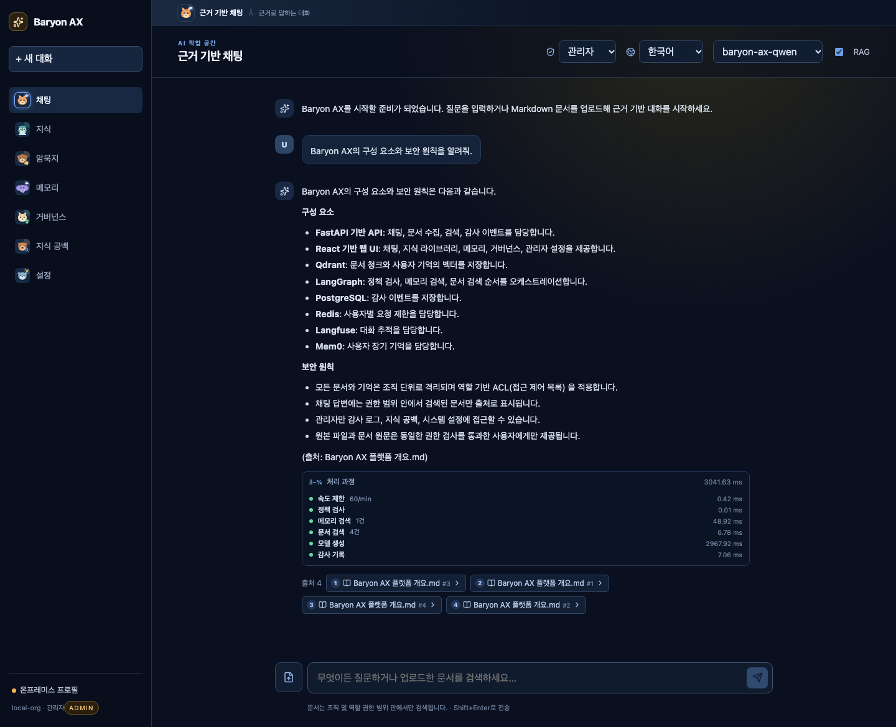</a></td>
<td valign="top"><a href="#voice-secretary">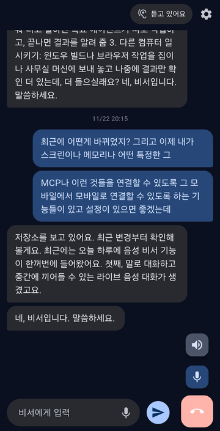</a></td>
</tr>
<tr>
<td align="center"><sub>웹: 근거 인용 답변과 처리 과정 trace</sub></td>
<td align="center"><sub>폰: 바리온 비서 앱 (통화 중)</sub></td>
</tr>
</table>

---

<a id="one-page"></a>
## 한 장으로 보기

<p align="center">

<b>&nbsp;+&nbsp;</b>

<b>&nbsp;+&nbsp;</b>

<b>&nbsp;+&nbsp;</b>

<b>&nbsp;+&nbsp;</b>

<b>&nbsp;+&nbsp;</b>

<br><b>≈</b><br>

</p>

**Glean + Palantir 온톨로지 + ChatGPT Enterprise + Slack AI + OpenAI dots·Pickle ≈ Baryon AX**. 다만 전부 사내 서버 안에서 돌고, 모델은 골라 쓰며, 답하지 못한 질문은 전문가에게 먼저 묻습니다.

<p align="center">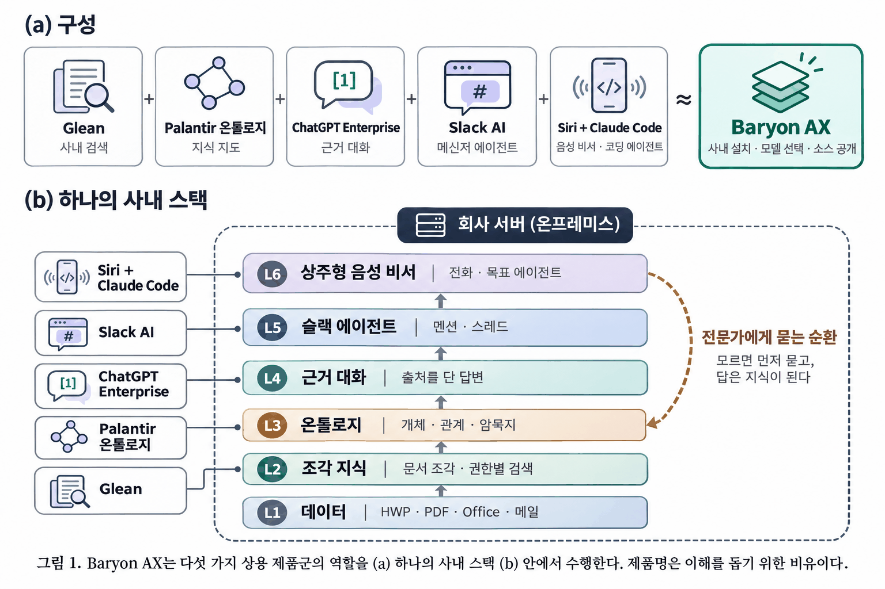</p>

**그림 읽는 법**

- **(a) 구성:** 따로 사야 하는 다섯 가지 상용 제품의 역할을 Baryon AX 하나가 맡습니다.
- **(b) 하나의 사내 스택:** 그 역할이 회사 서버 안의 여섯 층으로 쌓입니다. 아래(데이터)에서 위(상주형 비서)로 갈수록 사람에게 가까워집니다.
- **주황 점선:** 비서와 봇이 답하지 못한 질문은 전문가에게 먼저 묻고, 그 답이 온톨로지와 지식으로 돌아가 다음 사람은 바로 답을 받습니다.

<details>
<summary>단계별 세로 그림 보기</summary>

<p align="center">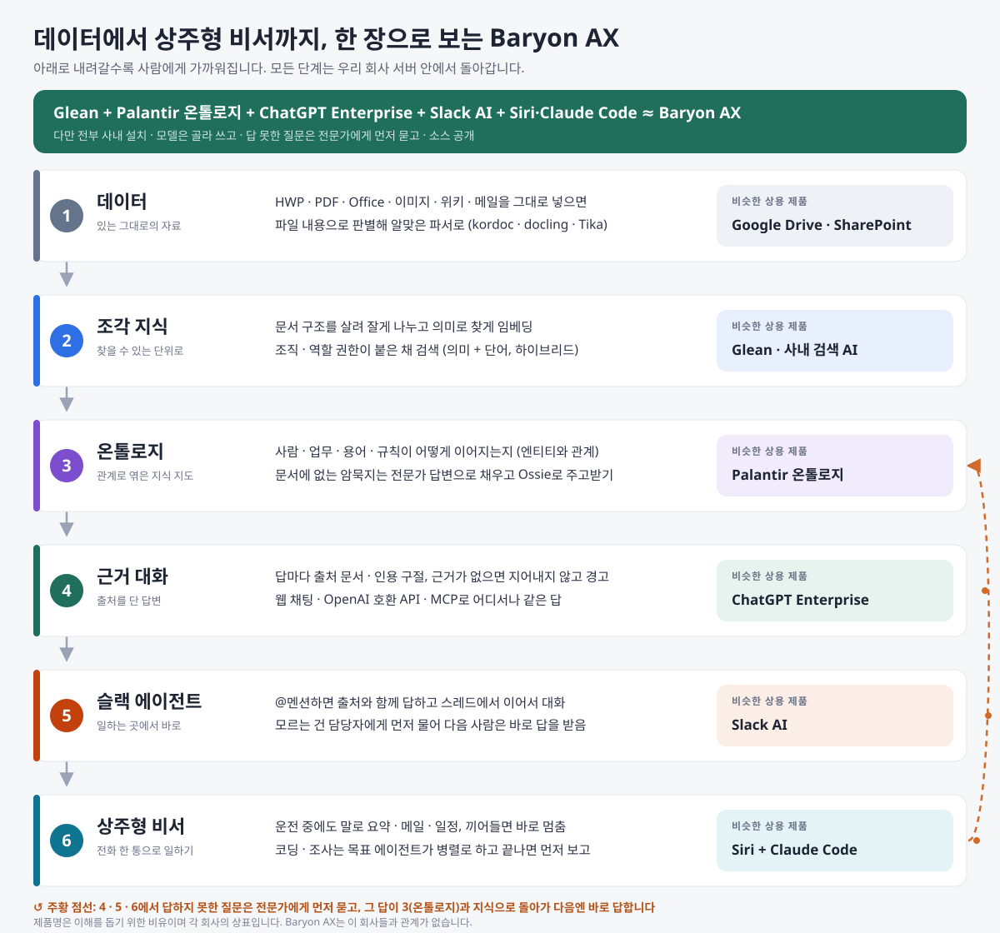</p>

</details>

| 단계 | 하는 일 | 비슷한 상용 제품 |
| --- | --- | --- |
| 1. 데이터 | HWP·PDF·Office·위키·메일을 그대로 넣고 내용으로 판별해 파싱 | Google Drive · SharePoint |
| 2. 조각 지식 | 구조를 살려 나누고 권한이 붙은 채 의미·단어로 검색 | Glean |
| 3. 온톨로지 | 사람·업무·용어의 관계, 문서에 없는 암묵지를 전문가 답으로 채움 | Palantir 온톨로지 |
| 4. 근거 대화 | 출처·인용을 단 답, 근거 없으면 지어내지 않음 | ChatGPT Enterprise |
| 5. 슬랙 에이전트 | 멘션하면 출처와 함께 답하고, 모르면 담당자에게 먼저 질문 | Slack AI |
| 6. 상주형 비서 | 전화로 요약·메일·일정, 나를 기억하고, 코딩·조사는 목표 에이전트가 병렬로 | OpenAI dots · Pickle |

<sub>제품명은 이해를 돕기 위한 비유이며 각 회사의 상표입니다. Baryon AX는 이 회사들과 관계가 없습니다.</sub>

### 단계별 증거: 실제 화면

비유가 아니라 지금 동작하는 화면입니다. 이미지를 누르면 크게 볼 수 있습니다.

<table>
<tr>
<td width="33%" valign="top"><a href="docs/images/gallery/03-knowledge.png">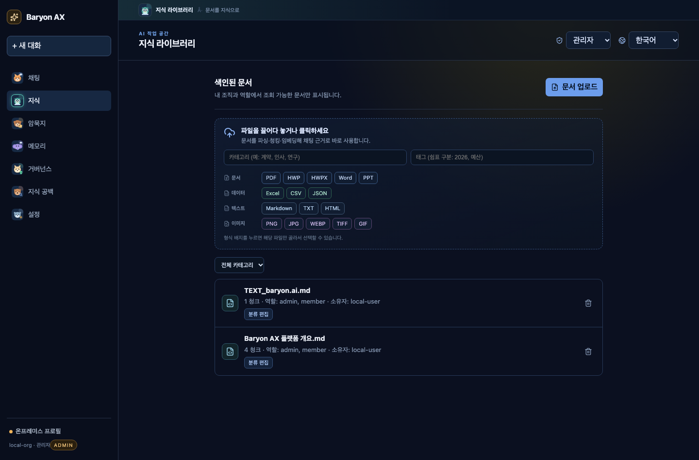</a><br><b>1. 데이터</b><br><sub>HWP·HWPX·PDF·Word·Excel·이미지를 그대로 올리면 색인 문서로 쌓입니다. 문서마다 역할 권한이 붙습니다.</sub></td>
<td width="33%" valign="top"><a href="docs/images/gallery/02-source-viewer.png">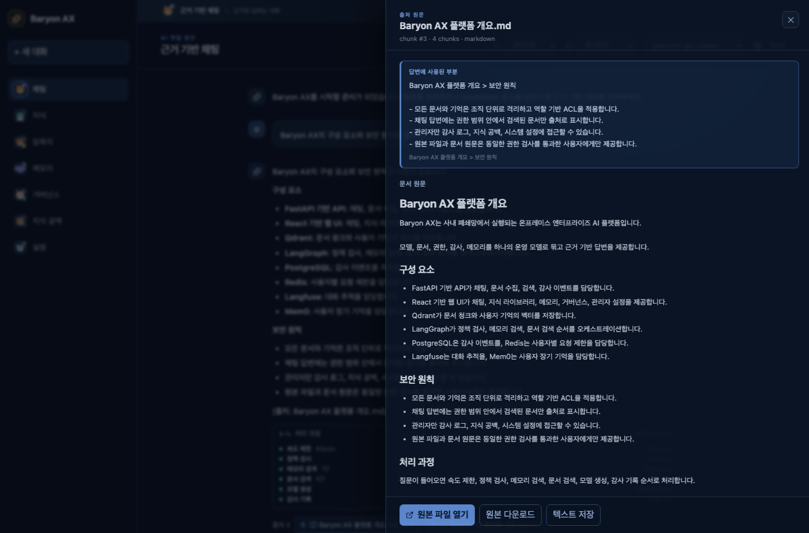</a><br><b>2. 조각 지식</b><br><sub>답변에 쓰인 조각(chunk #5 · 4 chunks)과 인용 구절을 원문 위에 그대로 보여 줍니다.</sub></td>
<td width="33%" valign="top"><a href="docs/images/gallery/06-knowledge-gaps.png">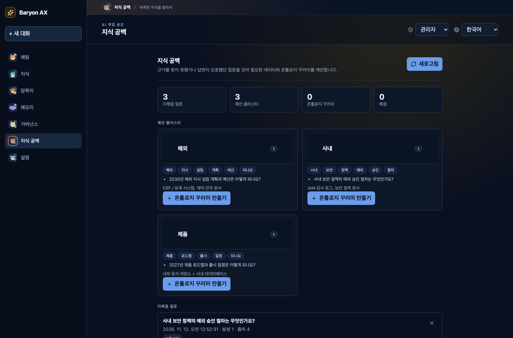</a><br><b>3. 온톨로지</b><br><sub>답하지 못한 질문을 공백 묶음으로 모으고, 한 번에 온톨로지 꾸러미(개체·관계·수용 질문)로 만듭니다.</sub></td>
</tr>
<tr>
<td width="33%" valign="top"><a href="docs/images/gallery/01-chat.png"></a><br><b>4. 근거 대화</b><br><sub>답 아래에 출처 문서와 처리 과정(정책 → 메모리 → 검색 → 모델 → 감사)이 붙습니다.</sub></td>
<td width="33%" valign="top"><a href="examples/slack-bot/docs/slack-thread-example.svg">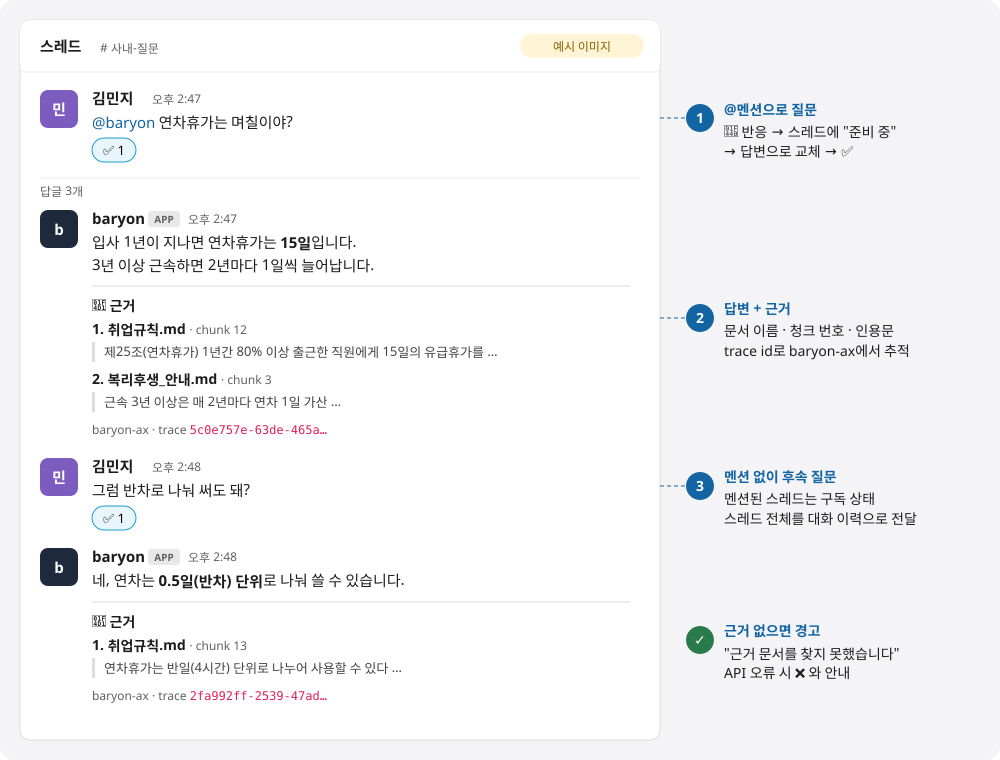</a><br><b>5. 슬랙 에이전트</b><br><sub>멘션하면 출처와 함께 답하고 스레드에서 이어 갑니다. <i>예시 그림입니다. 실제 캡처는 준비 중입니다.</i></sub></td>
<td width="33%" valign="top"><a href="docs/images/voice-app/chat.png"></a><br><b>6. 상주형 비서</b><br><sub>바리온 비서 앱의 통화 화면. 말로 묻고 맡긴 대화가 그대로 남고, 설정에서 기억·연결·두뇌를 고릅니다.</sub></td>
</tr>
</table>

<sub>암묵지 질문과 게시(<a href="docs/images/gallery/08-tacit-knowledge.png">암묵지 화면</a>), 사용자 메모리, 감사 로그, 설정 화면은 <a href="docs/screenshots.md">스크린샷 모음</a>에 있습니다.</sub>

---

## 목차

- [한 장으로 보기](#one-page) · [왜 Baryon AX인가](#why) · [무엇을 할 수 있나](#features) · [What's new](#whats-new)
- [빠른 시작](#quick-start) · [기존 설치 업데이트](#updating-an-existing-install) · [실행 구성](#profiles)
- [음성 비서: 말로 일하기](#voice-secretary) · [아키텍처](#architecture) · [암묵지 지식화 사이클](#tacit--explicit-cycle)
- [연동: API · 메신저 봇 · MCP](#integrations) · [설정](#configuration) · [API](#api)
- [보안](#security) · [로드맵](#roadmap) · [문서 지도](#docs) · [개발·기여](#development) · [English](#english)

---

<a id="why"></a>
## 왜 Baryon AX인가

기업 AI 도입이 막히는 이유는 기술보다 **신뢰**입니다. Baryon AX는 그 세 가지 질문에 구조로 답합니다.

| 도입 현장의 걱정 | Baryon AX의 답 |
| --- | --- |
| **"사내 문서를 외부 AI에 넣을 수 없다."** | 전부 고객 환경 안에서 실행합니다. 모델은 Ollama·vLLM 등 사내 서버를 OpenAI 호환 방식으로 연결하고, 폐쇄망 구성도 지원합니다. |
| **"AI가 지어낸 답을 믿을 수 없다."** | 답변마다 출처 문서·청크·인용 구절을 보여 주고, 근거가 없으면 지어내지 않고 경고합니다. 검색은 **모델에 넣기 전에** 조직·역할 권한으로 거릅니다. |
| **"정작 중요한 판단 기준은 문서에 없다."** | 답하지 못한 질문을 지식 공백으로 모아 **전문가에게 먼저 묻고**, 답변을 게시하면 다음 대화의 근거가 됩니다. |
| **"보안 심사를 통과해야 한다."** | 조직·역할 ACL, 모든 요청의 감사 로그, OIDC 인증, PR마다 자동 보안 점검(P0/P1이면 병합 차단)을 갖췄습니다. |
| **"HWP 문서가 대부분이다."** | 파일 내용(MIME)으로 판별해 HWP·HWPX는 kordoc, PDF·Office·이미지는 docling, 그 밖은 Tika로 보냅니다. |
| **"PoC에 GPU 견적부터 필요하다."** | 맥미니와 Docker만 있으면 **한 줄**로 시작합니다. GPU는 필요할 때 연결합니다. |

<a id="features"></a>
## 무엇을 할 수 있나

<table>
<tr>
<td width="50%" valign="top">

**💬 대화**
- 근거 인용 스트리밍 답변, 출처 뷰어(인용 구절 · 원문 · 원본 파일)
- 처리 과정 trace(요청 제한 → 정책 → 메모리 → 검색 → 모델 → 감사)
- 근거 없음 경고, 중지 · 다시 생성 · 복사, 👍/👎 피드백
- 사용자별 장기 기억(Mem0)을 다음 답변에 주입
- 입력창에서 `/`로 MCP 도구 선택

</td>
<td width="50%" valign="top">

**📚 지식**
- HWP · HWPX · PDF · Office · 이미지 · 텍스트 업로드(MIME 라우팅)
- 구조 인식 청킹(제목 경로 · 표 머리글)
- Qdrant 벡터 검색, 하이브리드 검색(벡터 + 어휘 RRF)
- FastEmbed 또는 OpenAI 호환 임베딩
- Apache Ossie 의미 모델 가져오기 · 내보내기

</td>
</tr>
<tr>
<td valign="top">

**🦦 암묵지 루프**
- 근거 없는 질문을 지식 공백으로 기록 · 클러스터링
- 유휴 시간에 전문가 질문 큐 생성, 답변 → 게시 → 검증
- 온톨로지 팩 초안, Ossie 초안 내려받기
- Slack에서 담당자에게 먼저 묻는 proactive 모드

</td>
<td valign="top">

**🛡️ 거버넌스 · 연동**
- 조직 · 역할 · 문서 ACL, 관리자 설정 · 시스템 상태
- PostgreSQL 감사 로그 + JSONL, Langfuse 트레이스
- OIDC 인증, 웹 PKCE 로그인, 봇 · MCP용 서비스 계정 위임
- OpenAI 호환 `/v1/chat/completions`, MCP 서버 `POST /mcp`
- Slack · Discord 봇 예제

</td>
</tr>
<tr>
<td valign="top">

**🎙 음성 비서 · 모바일 앱**
- 받아쓰기 · 음성 명령 · 끼어들 수 있는 라이브 대화 (사내 STT · TTS)
- 안드로이드 앱 **바리온 비서**: 일반 통화로 잡혀 차량 블루투스로 대화
- 메일 · 일정 · 할 일 · PR/CI를 2~3문장으로 요약, 바뀌는 일은 "응"을 들어야 실행
- 띠링 · 톡 · 뚝 · 딩동 효과음으로 화면 없이도 상태 파악

</td>
<td valign="top">

**🤖 상주 비서 + 목표 에이전트**
- 대화로 맡긴 목표를 백그라운드 에이전트가 병렬로 처리
- 목표마다 전용 git 브랜치 · 샌드박스, push · 발송은 하지 않음
- 막히면 질문하고, 끝나면 비서가 먼저 말로 보고
- 진행 단계와 작업 카드가 앱 화면에 실시간으로 표시

</td>
</tr>
</table>

한국어·영어 UI, 키보드 중심 입력창, 모바일 화면, `aria-live` 상태 안내 등 접근성도 기본으로 갖췄습니다. 화면 8종은 [docs/screenshots.md](docs/screenshots.md), 기능 전체 목록은 [docs/features.md](docs/features.md)에 있습니다.

<table>
<tr>
<td><a href="docs/screenshots.md"></a><br><sub>출처 뷰어: 인용 구절과 원문</sub></td>
<td><a href="docs/screenshots.md">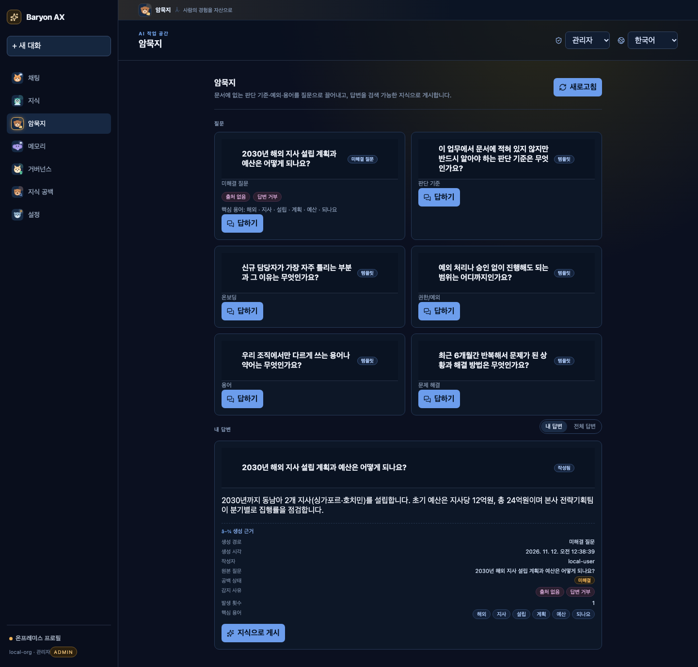</a><br><sub>암묵지: 생성 근거와 게시 상태</sub></td>
<td><a href="docs/screenshots.md">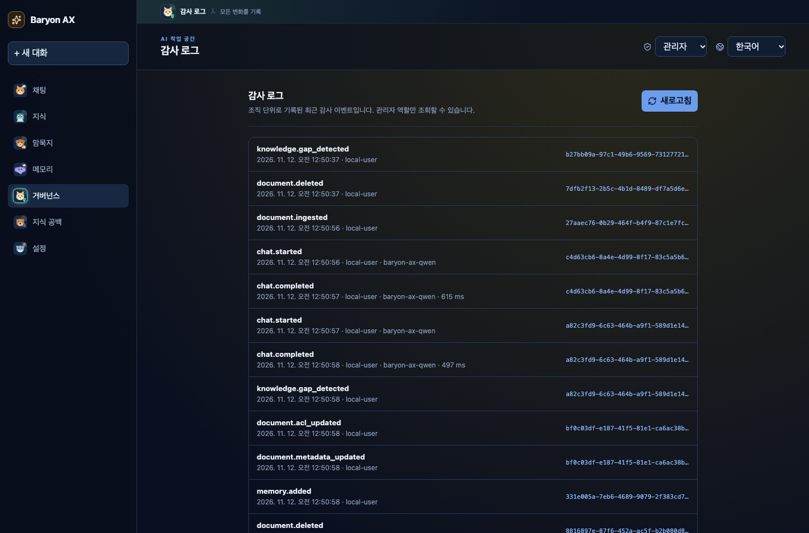</a><br><sub>거버넌스: 감사 이벤트와 trace ID</sub></td>
</tr>
</table>

<a id="whats-new"></a>
## What's new

**다음 릴리스 (main에 반영됨) — 말로 일하는 비서**

- **음성**: 받아쓰기와 음성 명령, 말하면 멈추는 라이브 대화. sherpa-onnx STT와 Supertonic TTS가 사내에서만 돕니다 ([voice.md](docs/voice.md)).
- **음성 비서**: 메일 · 일정 · 할 일 · PR/CI를 요약하고 DureClaw 플릿에 일을 맡깁니다. 바뀌는 일은 음성 확인을 거쳐야 실행됩니다 ([voice-secretary.md](docs/voice-secretary.md)).
- **목표 에이전트**: 대화로 맡긴 목표를 백그라운드 에이전트 여러 개가 각자 브랜치에서 병렬로 처리하고, 끝나면 비서가 먼저 알려 줍니다.
- **바리온 비서 앱 · 전화**: Flutter 안드로이드 앱과 SIP 전화. 차량 블루투스로 쓰고, 상태는 효과음으로 알 수 있습니다 ([voice-app.md](docs/voice-app.md) · [phone.md](docs/phone.md)).
- **비서에게 알려 주기**: 앱에서 나에 대한 소개, 원하는 활용 방식, 기억, MCP 연결을 적고 켜고 끕니다. 통화 중 "이거 기억해 줘"라고 말해도 쌓입니다.
- **내 목소리만 듣기**: 말마다 잡음을 지우고(GTCRN), 휴대폰 가까이에서 한 말만 받아씁니다. 소음과 옆 사람 말은 요청으로 들어가지 않습니다.

**v0.7.0 — 사내 메신저 안에서 먼저 묻는 AI** · [릴리스 노트](https://github.com/baryonlabs/baryon-ax/releases/tag/v0.7.0)

- **Slack · Discord 봇**: 멘션하면 출처와 함께 답하고, 지식 공백은 담당자에게 먼저 묻습니다.
- **MCP 서버** `POST /mcp`: 검색 · 근거 답변 · 지식 공백 도구를 Claude, IDE, 에이전트 채팅 앱에 엽니다.
- **서비스 계정 위임 인증**: 봇과 MCP 게이트웨이가 사람마다 대신 요청해도 권한과 감사 기록은 사람 단위로 남습니다. 웹 OIDC 로그인(PKCE)도 추가했습니다.
- **하이브리드 검색 · OpenAI 호환 임베딩**, **Apache Ossie 지식 교환**, **MCP 도구 선택**

<a id="quick-start"></a>
## 빠른 시작

> 필요한 것: Docker Desktop(또는 Docker Engine + Compose). **GPU와 API 키는 필요 없습니다.** 구성별 최소 사양은 [하드웨어 요구사항](docs/hardware-requirements.md)을 보세요.

### 1. 한 줄로 시작 (맥미니 · 노트북)

```bash
git clone https://github.com/baryonlabs/baryon-ax.git && cd baryon-ax && cp .env.example .env && docker compose up --build
```

첫 빌드는 10~20분 걸립니다. 끝나면 **http://localhost:3001** 을 엽니다. 처음에는 실제 모델 없이 `demo-local`로 동작합니다.

### 2. 실제 모델 연결

OpenAI 호환 `/v1/chat/completions`를 제공하는 서버라면 무엇이든 연결됩니다. 호스트의 Ollama를 쓰는 예:

```bash
python3 scripts/ollama_proxy.py --listen-port 11435 &   # 호스트 127.0.0.1:11434 → 컨테이너에서 접근 가능하게
docker compose up -d --build api                        # MODEL_BASE_URL_DOCKER · MODEL_NAME(기본 qwen2.5:7b)을 읽음
curl -s http://localhost:8000/health                    # model_adapter: openai-compatible 이면 연결됨
```

사내 GPU의 vLLM은 `MODEL_BASE_URL_DOCKER`를 그 주소로, `MODEL_NAME`을 모델 ID로 바꾸면 됩니다. 모델·정밀도 선택은 [모델·하드웨어 선택 가이드](docs/model-hardware-selection.md)를 참고하세요.

### 3. HWP · PDF · Office · 이미지 읽기

```bash
docker compose -f docker-compose.yml -f docker-compose.parsers.yml --profile parsers up -d --build
```

### 4. 운영 구성 (Qdrant · PostgreSQL · Redis · Langfuse · Mem0)

```bash
python3 scripts/ollama_proxy.py --listen-port 11435 &
OLLAMA_HOST_URL=http://host.docker.internal:11435 \
  docker compose -f docker-compose.yml -f docker-compose.full.yml --profile deps up -d --build
```

UI는 `http://localhost:3001`, API는 `http://localhost:8000`입니다(Langfuse가 3000을 씁니다). 준비·검증·문제 해결은 [docs/full-stack.md](docs/full-stack.md)에 있습니다.

<a id="updating-an-existing-install"></a>
### 기존 설치 업데이트

처음 시작할 때 쓴 Compose 파일 그대로 다시 빌드합니다. 문서 · 감사 · 공백 · 암묵지 · 메모리 데이터는 Compose 볼륨에 남습니다. **`docker compose down -v`는 실행하지 마세요.**

```bash
git pull --ff-only
docker compose up -d --build                     # 운영 구성이면 -f docker-compose.full.yml 등을 그대로 붙임
curl -s http://localhost:8000/health             # 버전과 연결 상태 확인
```

- 빌드 후에도 `docker compose ps`가 옛 컨테이너를 보여 주면 `docker compose up -d --force-recreate api web`으로 다시 만듭니다.
- 파서 사이드카를 쓰면 파서도 다시 빌드합니다: `docker compose -f docker-compose.yml -f docker-compose.parsers.yml --profile parsers up -d --build`
- Docker 없이 개발 중이면 `cd apps/api && uv sync --extra dev`로 의존성을 다시 맞춥니다.

<a id="profiles"></a>
### 실행 구성

| 구성 | 실행되는 것 | 최소 사양 | 시작 |
| --- | --- | --- | --- |
| Basic Core | `api`, `web`, `demo-local`, 파일 저장소 | 2 vCPU · 4 GB · GPU 없음 | `docker compose up --build` |
| + 파서 | kordoc, docling, Tika | 디스크 여유(docling 이미지 10 GB+) | `-f docker-compose.parsers.yml --profile parsers` |
| 운영 구성 | + Qdrant, PostgreSQL, Redis, Langfuse, Mem0 | 8 vCPU · 16 GB | `-f docker-compose.full.yml --profile deps` |
| + 인증 | Keycloak (OIDC) | — | `-f docker-compose.auth.yml` · [auth-oidc.md](docs/auth-oidc.md) |
| + MCP 도구 | ContextForge 게이트웨이 | — | `-f docker-compose.mcp.yml` · [mcp-connectors.md](docs/mcp-connectors.md) |
| + 음성 (받아쓰기 · 라이브 대화) | sherpa-onnx STT + Supertonic TTS (CPU) | — | `-f docker-compose.voice.yml` · [voice.md](docs/voice.md) |
| + 음성 비서 | Claude Agent SDK (작업자 PC) + MCP · DureClaw | — | `apps/secretary` · [voice-secretary.md](docs/voice-secretary.md) |
| + 전화 (차량 블루투스) | Asterisk + 전화 게이트웨이, 휴대폰 SIP 앱 | — | `-f docker-compose.phone.yml` · [phone.md](docs/phone.md) |
| + 모바일 앱 (바리온 비서) | Flutter 안드로이드 앱 → 게이트웨이(WebSocket) | — | `apps/voice_app` · [voice-app.md](docs/voice-app.md) |
| GPU 추론 | vLLM 등 사내 GPU 모델 | 7B: RTX 4090 24 GB 1장부터 | [b300-host-deploy.md](docs/b300-host-deploy.md) |
| AWS | ECS Fargate · RDS · Bedrock, 데모 · 멀티테넌트 · 고객 전용 | 데모 약 $130/월(업무시간) | [aws-deploy.md](docs/aws-deploy.md) |
| Kubernetes | API 스타터 매니페스트 | — | `deploy/kubernetes` |

<a id="voice-secretary"></a>
## 음성 비서: 말로 일하기

운전 중이거나 손이 바쁠 때, 전화 한 통으로 요약을 듣고 일을 맡깁니다. 음성은 사내 서버에서만 처리됩니다.

```text
📞 비서  네, 비서입니다. 말씀하세요.
🙂 나    열린 PR이랑 CI 상태 알려줘
📞 비서  (띠링) 열린 PR은 두 개예요. CI는 모두 통과했어요. …
🙂 나    로그인 버그 고쳐서 테스트 통과시켜 줘
📞 비서  목표 에이전트에게 맡길까요? (딩-동?)
🙂 나    응
📞 비서  맡겼어요. 끝나면 먼저 알려 드릴게요.
```

<table>
<tr>
<td width="34%"><br><sub>통화 화면: 대화가 화면의 중심</sub></td>
<td width="34%">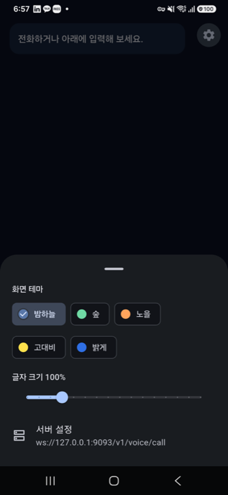<br><sub>설정: 주변 소리 거르기 (내 목소리만)</sub></td>
<td valign="top">

**이렇게 말하면**

- "열린 PR이랑 CI 상태 알려줘"
- "우선순위 높은 할 일 세 개만"
- "로그인 버그 고쳐서 테스트 통과시켜 줘" → "목표 에이전트에게 맡길까요?" → "응"
- "지금 뭐 하고 있어?"
- 비서가 말하는 중에 끼어들면 바로 멈춥니다

</td>
</tr>
</table>

```text
📱 바리온 비서 앱 (Flutter · 안드로이드 통화 = 차량 블루투스)      📞 SIP 앱 (Linphone · Asterisk)
        │ wss 16 kHz · 기기 토큰                                       │ 8 kHz
        └──────────────────────▶ 전화 게이트웨이 ◀──────────────────────┘
                                VAD → STT(Whisper · SenseVoice) → 상주 비서 → TTS(Supertonic)
                                                    │
                    조회는 바로 · 바뀌는 일은 "응" 후에 · 파괴적 명령은 차단
                                                    ├─▶ 목표 에이전트 #1 ┐ 전용 브랜치 · 샌드박스
                                                    ├─▶ 목표 에이전트 #2 ├ 병렬 실행
                                                    └─▶ 목표 에이전트 #3 ┘ 끝나면 먼저 보고
```

| 효과음 | 뜻 |
| --- | --- |
| 띠링 | 말을 알아들었어요 |
| 톡 … 톡 | 생각하는 중 · 작업 중 |
| 뚝 | 멈췄어요 (끼어들기, "멈춰") |
| 딩-동? | 대답이 필요해요 ("응" / "아니") |
| 도-미-솔 | 맡긴 백그라운드 작업이 끝났어요 |

### 소통 파이프라인 (UML)

음성 한 마디가 어떻게 흐르는지 UML로 정리했습니다. 유스케이스, 배치, 시퀀스(끼어들기 · 음성 확인 · 목표 에이전트), 목표 상태, 발화 필터 활동, 클래스까지 11개 다이어그램 전체는 [docs/voice-architecture.md](docs/voice-architecture.md)에 있습니다.

<details open>
<summary><b>컴포넌트 다이어그램</b>: 무엇이 있고 어떻게 연결되나</summary>

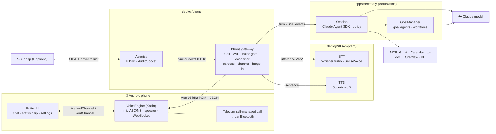

</details>

<details>
<summary><b>시퀀스 다이어그램</b>: 말 한 마디가 답이 되기까지</summary>

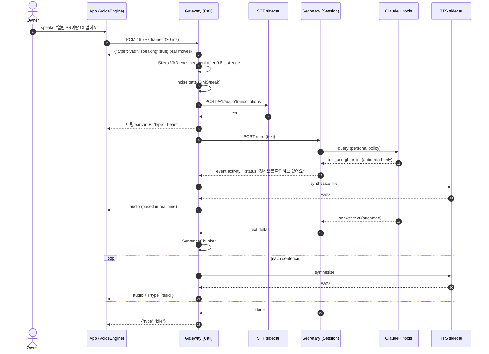

</details>

<details>
<summary><b>상태 다이어그램</b>: 통화 중 비서의 상태와 효과음</summary>

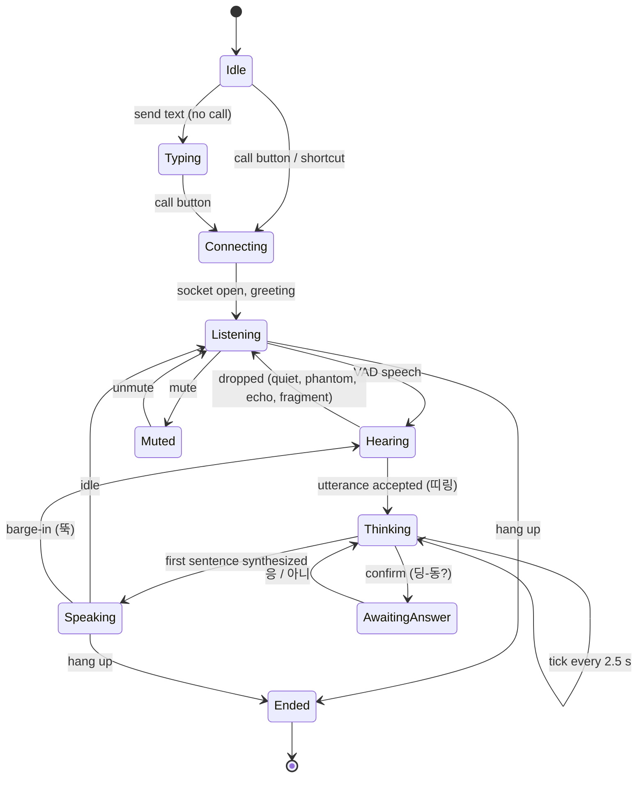

</details>

시작하기: 음성 프로필(`docker-compose.voice.yml`)로 STT · TTS를 띄우고, 작업자 PC에서 `apps/secretary`를 실행한 뒤, 전화 게이트웨이(`docker-compose.phone.yml`)와 앱을 연결합니다. 자세한 순서는 [voice-secretary.md](docs/voice-secretary.md) → [voice-app.md](docs/voice-app.md)에 있습니다.

<a id="architecture"></a>
## 아키텍처

Baryon AX는 **채널 → 게이트웨이 → 오케스트레이션 → 지식·모델·메모리 → 거버넌스** 순서로 요청을 처리합니다. 모든 요청은 게이트웨이에서 신원과 권한을 확정한 뒤에만 지식과 모델에 닿고, 모든 단계는 같은 `trace_id`로 감사 기록과 트레이스에 이어집니다.

### 1. 전체 아키텍처

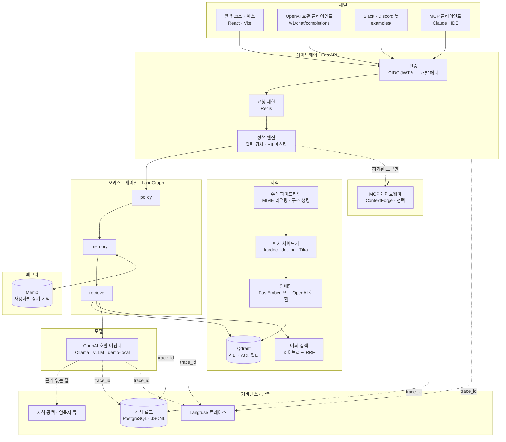

| 계층 | 하는 일 | 구현 위치 |
| --- | --- | --- |
| 채널 | 사람이 묻는 곳. 웹, OpenAI 호환 API, 메신저 봇, MCP 클라이언트가 같은 API를 씁니다. | `apps/web`, `/v1/chat/completions`, `examples/` |
| 게이트웨이 | 신원 확정(OIDC 또는 개발 헤더), 요청 제한, 입력 정책과 PII 마스킹. 브라우저와 봇은 모델·벡터 저장소에 직접 닿지 않습니다. | `auth.py`, `RateLimiter`, `PolicyEngine` |
| 오케스트레이션 | `policy → memory → retrieve` 그래프로 근거를 모은 뒤 모델 스트리밍과 출력 마스킹을 수행합니다. | `main.py`의 LangGraph `StateGraph` |
| 지식 | 파일을 MIME으로 판별해 파서로 보내고, 구조를 살려 청킹·임베딩해 Qdrant에 넣습니다. 검색은 조직·역할 ACL을 **모델에 넣기 전에** 적용합니다. | `ingest/`, `DocumentService`, `VectorIndex` |
| 모델 | OpenAI 호환 `/chat/completions`이면 무엇이든 연결합니다. 모델이 없으면 `demo-local`로 동작합니다. | `ModelAdapter` |
| 메모리 | 사용자별 장기 기억을 저장·검색해 답변에 넣습니다. | `MemoryService` (Mem0) |
| 도구 | MCP 도구는 서버가 역할 권한을 다시 확인한 것만 모델에 노출합니다. | `connectors.py`, `mcp.py` |
| 거버넌스 | 모든 요청·업로드·게시·도구 호출을 감사 로그와 트레이스로 남기고, 근거 없는 답은 지식 공백으로 기록합니다. | `AuditSink`, Langfuse, `gaps.py` |

### 2. 기능 구조

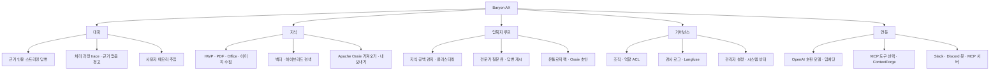

다섯 기능 묶음은 따로 노는 모듈이 아니라 한 루프로 이어집니다. **대화**가 근거를 찾지 못하면 **암묵지 루프**가 공백으로 기록하고 전문가에게 질문합니다. 게시된 답변은 **지식**의 같은 수집 파이프라인을 거쳐 다음 **대화**의 근거가 됩니다. 이 모든 단계는 **거버넌스**의 ACL과 감사 아래에서 움직이고, **연동**은 같은 루프를 메신저와 외부 도구로 넓힙니다.

### 3. 질문 하나가 처리되는 순서

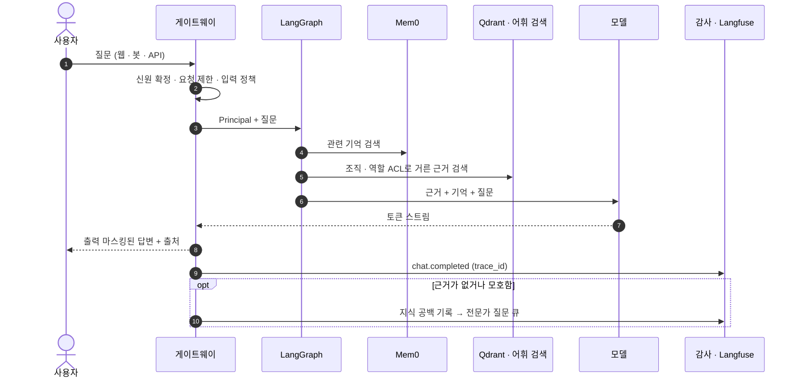

### 4. 지식이 쌓이는 경로

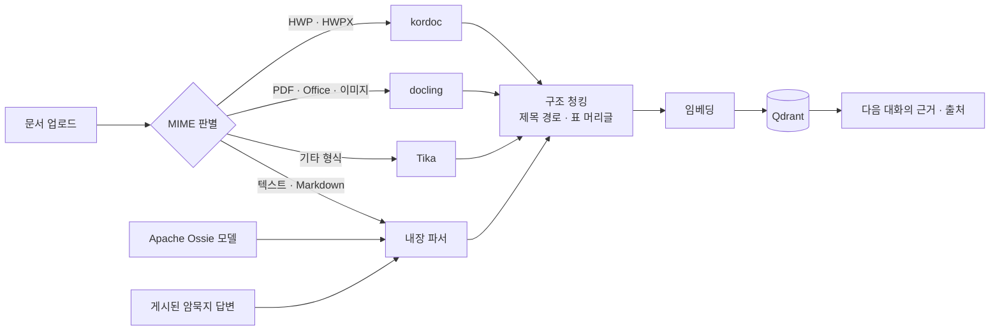

업로드 문서, Ossie 의미 모델, 게시된 암묵지 답변은 모두 **같은 파이프라인**을 거칩니다. 그래서 출처 표시, 권한 필터, 재색인이 지식의 출처와 관계없이 똑같이 적용됩니다.

<details>
<summary>수집 파이프라인 상세 (원본 보관 → 라우터 → 파서 → Document IR → 청커 → 임베더 → Qdrant · 지식 카탈로그)</summary>

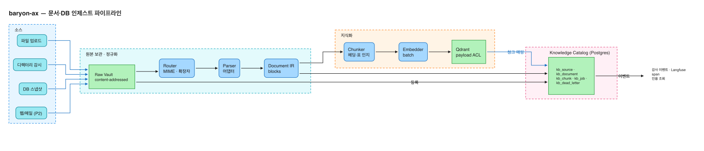

편집 가능한 원본은 [Excalidraw 보드](https://app.excalidraw.com/s/71iHvWeZdL/5PvcKxcjuan), 설계 설명은 [docs/ingestion/architecture.md](docs/ingestion/architecture.md)에 있습니다.

</details>

<a id="tacit--explicit-cycle"></a>
## 암묵지 지식화 사이클

문서에 없는 판단 기준, 예외 처리, 사내 용어, 장애 대응 노하우를 **감지 → 질문 → 답변 → 지식화 → 검증 → 환류** 루프로 문서화합니다. 핵심은 "사람이 아는 것을 문서로 옮기는 일"을 일회성 인터뷰가 아니라 **운영되는 사이클**로 만드는 것입니다.

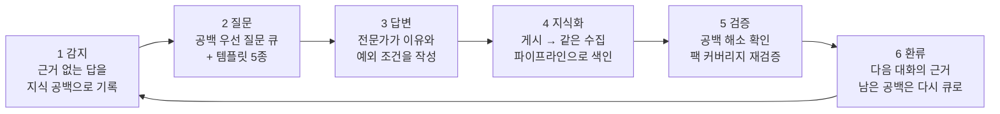

| 단계 | 하는 일 | 구현 |
| --- | --- | --- |
| **1. 감지** | 인용이 없거나 모호한 답변을 지식 공백으로 기록하고, 질문 · 이유 · 발생 횟수를 누적합니다. | `record_knowledge_gap`, `GapStore`, `/v1/admin/gaps` |
| **2. 질문** | 열린 공백을 최우선으로 질문 큐에 올리고, 부족하면 5개 템플릿(판단 기준 · 온보딩 · 권한/예외 · 용어 · 문제 해결)으로 보완합니다. | `suggest_questions`, `GET /v1/tacit/questions` |
| **3. 답변** | 담당자가 결론만이 아니라 **이유와 예외 조건**을 작성합니다. 기존 문서를 첨부할 수 있고, 초안은 작성자 또는 관리자만 수정합니다. | `TacitStore`, `POST/PATCH /v1/tacit/entries` |
| **4. 지식화** | 게시하면 `# 암묵지: {질문}` Markdown 문서가 생성되고, 일반 업로드와 **같은 파이프라인**을 거쳐 검색 가능한 지식이 됩니다. | `POST /v1/tacit/entries/{id}/publish` |
| **5. 검증** | 게시된 답변이 원래 공백을 해소했는지 확인하고 연결된 공백을 닫습니다. 온톨로지 팩이 있으면 수용 질문으로 커버리지를 재검증합니다. | `knowledge.gap_resolved`, `verify_pack` |
| **6. 환류** | 게시된 문서는 다음 대화부터 출처와 함께 쓰이고, 해결되지 않은 공백은 다시 질문 큐로 돌아갑니다. | 채팅 검색, `GET /v1/tacit/entries` |

<details>
<summary><b>운영 원칙</b></summary>

- **결론보다 판단 근거를 적습니다.** "예외는 팀장 승인"보다 "왜, 어느 범위까지, 어떤 경우에"를 남겨야 재사용됩니다.
- **한 번에 하나의 질문**에 답합니다. 질문을 쪼개면 검색 청크가 작아지고 인용 정확도가 올라갑니다.
- **공백에서 시작합니다.** 템플릿보다 실제로 답변에 실패한 질문이 신호가 큽니다.
- **게시 전 검토합니다.** 게시된 답변은 수정할 수 없으므로 초안 단계에서 작성자 · 관리자가 확인합니다.
- **권한을 유지합니다.** 답변과 첨부는 조직 · 역할 ACL을 따르고, 게시 문서는 `member`/`admin` 역할에 공개됩니다.
- 모든 기록과 게시는 `tacit.recorded`, `tacit.published`, `knowledge.gap_resolved` 감사 이벤트로 남습니다.

UI의 **암묵지** 탭에서 질문 큐, 내 답변, 전체 답변, 게시 상태와 각 항목의 생성 근거(생성 경로 · 원본 질문 · 감지 사유 · 발생 횟수 · 게시 문서)를 볼 수 있습니다. 저장소는 `/data/gaps`, `/data/tacit`에 있어 재시작 후에도 유지됩니다.

</details>

<a id="integrations"></a>
## 연동: API · 메신저 봇 · MCP

모든 채널이 **같은 API와 같은 권한 · 감사 경로**를 씁니다. 그래서 어디서 물어도 답의 근거와 기록 방식이 같습니다.

### OpenAI 호환 API

```bash
curl -N http://localhost:8000/v1/chat/completions \
  -H 'Content-Type: application/json' \
  -H 'X-User-Id: me' -H 'X-Organization-Id: local-org' -H 'X-Roles: member' \
  -d '{"model": "demo-local", "messages": [{"role": "user", "content": "연차 이월 기준이 뭐야?"}]}'
```

문서 올리기:

```bash
curl -s http://localhost:8000/v1/documents \
  -H 'X-User-Id: me' -H 'X-Organization-Id: local-org' -H 'X-Roles: admin' \
  -F file=@./연차규정.hwp -F allowed_roles=member,admin
```

`X-User-Id` 등 개발용 헤더는 `AUTH_MODE=dev`(기본값)에서만 믿습니다. 운영에서는 `AUTH_MODE=oidc`로 Bearer 토큰을 검증합니다([docs/auth-oidc.md](docs/auth-oidc.md)).

<a id="messenger-bots"></a>
### 메신저 봇

공개 API만 쓰는 예제라서 플랫폼 옆에서 따로 실행합니다.

| 예제 | 하는 일 |
| --- | --- |
| [`examples/slack-bot`](examples/slack-bot) | Slack `@멘션`(Socket Mode)에 **답변 + 출처**(문서 · 청크 · 인용 구절)로 답하고, 같은 스레드에서는 멘션 없이 이어 답합니다. **proactive 모드**는 답하지 못한 질문을 데스크 채널에 올리고, 스레드 답글을 초안으로 받아 작성자 승인 후 게시하고, 원래 스레드에 결과를 돌려줍니다. |
| [`examples/discord-bot`](examples/discord-bot) | 같은 기능의 Discord 봇(Gateway, 공개 URL 불필요). 멘션하면 스레드를 열어 답과 출처 embed를 보여 주고, 승인 버튼으로 답변을 게시합니다. |

봇은 OIDC 서비스 계정 하나로 인증하고 사람마다 `X-On-Behalf-Of: slack:<ID>`로 요청합니다. 역할은 서비스 계정 권한을 넘지 못하고, 감사 로그에는 사용자와 `acting_service`가 함께 남습니다.

<p align="center"></p>
<p align="center"><sub>예시 데이터로 그린 그림이며 실제 화면 캡처가 아닙니다.</sub></p>

### MCP

| 방향 | 무엇 | 문서 |
| --- | --- | --- |
| **Baryon AX를 MCP 서버로** | `POST /mcp`로 검색 · 근거 답변 · 지식 공백 도구를 Claude, IDE, 에이전트 채팅 앱에 엽니다. 도구는 호출한 사람의 권한으로 실행됩니다. | [docs/mcp-server.md](docs/mcp-server.md) |
| **MCP 도구를 Baryon AX로** | ContextForge 게이트웨이로 사내 · SaaS 도구를 연결하고, 입력창에서 `/`로 고른 도구만 서버가 권한을 다시 확인해 모델에 노출합니다. | [docs/mcp-connectors.md](docs/mcp-connectors.md) |

```bash
claude mcp add --transport http baryon http://127.0.0.1:8000/mcp \
  --header "X-User-Id: me" --header "X-Organization-Id: local-org" --header "X-Roles: member"
```

### Apache Ossie

**지식** 화면에서 Ossie 의미 모델(JSON/YAML)을 가져오면 데이터셋 · 필드 · 메트릭 · 관계가 검색 가능한 문서로 색인됩니다. 내보내기는 내 권한 범위의 지식만 `baryon-knowledge.ossie.json`으로 내려받습니다(`POST /v1/ossie/import`, `GET /v1/ossie/export`).

<a id="configuration"></a>
## 설정

모든 설정은 환경 변수(`.env`)로 합니다. 비워 두면 해당 기능은 꺼지거나 내장 대체 구현으로 동작합니다.

<details>
<summary><b>주요 환경 변수</b></summary>

| 변수 | 기본값 | 용도 |
| --- | --- | --- |
| `MODEL_BASE_URL` | 비어 있음 | OpenAI 호환 엔드포인트. 비우면 `demo-local` |
| `MODEL_NAME` | `qwen2.5:7b` | 모델 ID (운영 구성) |
| `MODEL_DISABLE_THINKING` | `false` | Qwen3.5/vLLM에 `enable_thinking=false` 전송 |
| `MODEL_PROMPT_PROFILE` | `auto` | 모델별 근거 시스템 프롬프트 (`qwen35`, `qwen`, `generic`) |
| `MODEL_TIMEOUT_SECONDS` | `180` | 모델 연결·응답 제한 시간 |
| `AUTH_MODE` | `dev` | `oidc`면 Bearer 토큰 검증. [auth-oidc.md](docs/auth-oidc.md) |
| `TENANCY_MODE` | `single` | `pooled`면 공유 인스턴스(등록된 테넌트만 허용, 쿼터·계량). [multi-tenancy.md](docs/multi-tenancy.md) |
| `QDRANT_URL` | 비어 있음 | 벡터 저장소 (비우면 어휘 검색) |
| `RETRIEVAL_MODE` | `vector` | `hybrid`면 벡터 + 어휘 검색 RRF |
| `RETRIEVAL_MIN_SCORE` | `0.3` | 인용으로 인정할 최소 유사도 |
| `EMBEDDING_PROVIDER` | `fastembed` | `openai`면 OpenAI 호환 `/v1/embeddings` |
| `EMBEDDING_MODEL` / `EMBEDDING_DIMENSION` | multilingual MiniLM / `384` | 임베딩 모델과 차원 |
| `DATABASE_URL` | 비어 있음 | PostgreSQL 감사 저장소 (비우면 JSONL만) |
| `REDIS_URL` | 비어 있음 | 요청 제한 (비우면 꺼짐) |
| `RATE_LIMIT_PER_MINUTE` | `60` | 사용자·조직별 분당 채팅 요청 수 |
| `LANGFUSE_ENABLED` / `LANGFUSE_HOST` | `false` / 로컬 | Langfuse 트레이스 |
| `MEM0_ENABLED` / `OLLAMA_BASE_URL` | `false` / 로컬 | Mem0 메모리 |
| `KORDOC_URL` · `DOCLING_URL` · `TIKA_URL` | 비어 있음 | 파서 사이드카 주소 |
| `PARSER_TIMEOUT_SECONDS` | `180` | 문서당 파서 제한 시간 |
| `MAX_DOCUMENT_BYTES` | `20000000` | 업로드 크기 제한 |
| `MCP_SERVER_ENABLED` | `true` | `POST /mcp` MCP 서버 |
| `DOCUMENT_STORE` · `AUDIT_LOG` | `/tmp/...` | 문서 JSON 디렉터리, JSONL 감사 로그 |

전체 목록과 설명은 [.env.example](.env.example)과 [docs/full-stack.md](docs/full-stack.md)에 있습니다.

</details>

<a id="api"></a>
## API

전체 스키마는 실행 중인 API의 `http://localhost:8000/docs`(OpenAPI)에서 볼 수 있습니다.

<details>
<summary><b>엔드포인트 요약</b></summary>

| 영역 | 엔드포인트 | 용도 |
| --- | --- | --- |
| 상태 | `GET /health` | 생존 확인, 버전, 연결된 어댑터 |
| 대화 | `POST /v1/chat/completions` | OpenAI 형식 채팅(SSE 스트리밍 포함) |
| 대화 | `GET /v1/models` | 호출자가 쓸 수 있는 모델 |
| 대화 | `POST /v1/feedback` | 👍/👎 답변 피드백 |
| 인증 | `GET /v1/auth/me` · `POST /v1/auth/login` · `POST /v1/auth/logout` | 현재 신원(위임 반영), 로그인·로그아웃 감사 |
| 문서 | `POST /v1/documents` | 업로드(MIME 라우팅, `?async=true`면 작업 ID) |
| 문서 | `GET /v1/jobs/{job_id}` | 비동기 수집 상태 |
| 문서 | `GET /v1/documents` · `GET /v1/documents/{id}` · `GET /v1/documents/{id}/file` | 목록, 권한 확인된 본문·인용 청크, 원본 파일 |
| 문서 | `PATCH /v1/documents/{id}` · `DELETE /v1/documents/{id}` | 분류·태그·ACL 변경, 삭제 |
| 문서 | `GET /v1/documents/search` | 권한 범위 검색 |
| Ossie | `POST /v1/ossie/import` · `GET /v1/ossie/export` | Ossie 의미 모델 가져오기·내보내기 |
| 메모리 | `POST` · `GET /v1/memories` · `GET /v1/memories/search` · `DELETE /v1/memories/{id}` | Mem0 사용자 기억 |
| 암묵지 | `GET /v1/tacit/questions` · `POST /v1/tacit/entries` · `POST /v1/tacit/entries/{id}/publish` | 질문 큐, 답변 저장, 게시 |
| 공백 | `GET /v1/admin/gaps` · `GET /v1/admin/gaps/clusters` · `POST /v1/admin/gaps/{id}/dismiss` | 지식 공백, 클러스터, 종료 (관리자) |
| 온톨로지 | `POST` · `GET /v1/admin/ontology-packs` · `GET /v1/admin/ontology-packs/{id}/ossie` | 팩 초안, Ossie 초안 (관리자) |
| 도구 | `GET /v1/connectors` · `GET /v1/tools/search` · `POST /v1/tools/{id}/call` | MCP 커넥터 카탈로그, 도구 검색·호출 |
| MCP | `POST /mcp` | MCP 서버(Streamable HTTP, JSON) |
| 관리 | `GET /v1/audit-events` · `GET /v1/admin/settings` · `POST /v1/admin/reindex` | 감사 이벤트, 실행 설정, 재색인 (관리자) |

</details>

<a id="security"></a>
## 보안

이 저장소는 **보안 인증이 아니라 검증 가능한 기준선**입니다. 운영 전에 [docs/security.md](docs/security.md)의 체크리스트를 따르세요.

| 경계 | 구현 |
| --- | --- |
| 신원 | 게이트웨이에서 확정합니다. 운영은 `AUTH_MODE=oidc`(JWKS 서명 · `iss` · `aud` · `exp` 검증), 개발 헤더는 `dev`에서만 믿습니다. |
| 권한 | 검색 결과는 조직 · 역할 ACL로 **모델에 넣기 전에** 거릅니다. MCP 도구도 서버가 역할을 다시 확인합니다. |
| 위임 | 서비스 계정은 `baryon-service` 역할이 있을 때만 `X-On-Behalf-Of`를 쓸 수 있고, 역할은 자기 권한을 넘지 못합니다. |
| 기록 | 대화 · 업로드 · 게시 · 도구 호출 · 인증 실패를 같은 `trace_id`로 감사 로그와 Langfuse에 남깁니다. |
| 출력 | 입력 정책 검사, PII 마스킹(스트리밍 청크 경계 포함). |

### PR마다 자동 보안 점검

모든 PR은 병합 전에 [security-sweep](https://github.com/baryonlabs/security-sweep)을 거칩니다. osv-scanner와 Trivy 결과를 OSV에서 실재 확인하고 CISA KEV · EPSS · 도달성으로 우선순위를 매겨 **P0/P1이면 병합을 막습니다.** OSV가 철회한 권고는 막지 않고, 조회가 실패하면 막습니다(fail-closed).

| 프로젝트 | 생태계 | 잠금 파일 | PR 의존성 점검 | 주간 이미지 점검 |
| --- | --- | --- | :---: | :---: |
| `apps/web` | npm | `package-lock.json` | ✅ | ✅ |
| `apps/api` | PyPI | `uv.lock` | ✅ | ✅ |
| `deploy/parsers/docling` | PyPI | 고정 `requirements.txt` | ✅ | 잠금 파일 SBOM |
| `deploy/parsers/kordoc` | npm | `package-lock.json` | ✅ | ✅ |
| `examples/*-bot` | PyPI | `requirements.txt` | ✅ | — |

<details>
<summary><b>점검이 하는 일과 하지 않는 일</b></summary>

- 매주 월요일 03:00 KST: 기본 브랜치 재점검, `api` · `web` · `kordoc` 이미지 점검과 CycloneDX SBOM, gitleaks 전체 히스토리 비밀 점검.
- 스캐너 커밋 · Trivy action SHA · osv-scanner 체크섬을 고정하고, 워크플로는 `contents: read`, 비밀 미사용입니다. 보고서가 없으면 통과로 보지 않습니다.
- 첫 점검에서 웹 이미지 root 실행(P1)을 막았고, 잠금 파일 사각지대를 없앤 뒤 `apps/api`의 의존성 63건(P1 42건)을 업그레이드로 해소했습니다.
- **알려진 취약점만** 봅니다. 권한 우회 같은 논리 결함은 SAST와 사람 리뷰가 필요합니다. P2/P3는 보고만 합니다. 유출된 비밀은 커밋 삭제가 아니라 교체해야 합니다.

운영 절차는 [docs/security-ci.md](docs/security-ci.md)에 있습니다.

</details>

<a id="roadmap"></a>
## 로드맵

| 릴리스 | 핵심 메시지 | 주요 내용 |
| --- | --- | --- |
| v0.6.0 ✅ | 첫 공개 | 근거 채팅, HWP 수집, ACL · 감사, 암묵지 루프, PR 보안 점검 |
| v0.7.0 ✅ | 사내 메신저 안에서 먼저 묻는 AI | Slack · Discord 봇, MCP 서버, 서비스 계정 위임, 하이브리드 검색 |
| main ✅ | 말로 일하는 비서 | 받아쓰기 · 라이브 대화, 음성 비서, 목표 에이전트, 바리온 비서 앱 · SIP 전화, 효과음 |
| v0.8.0 | 보안 심사를 통과하는 운영 기능 | 사용자 · 조직 · 역할 관리 UI, 감사 로그 검색 · 내보내기 · 보존, 백업 · 복구 런북, 공유 링크 |
| v0.9.0 | 지식 품질 | 온톨로지 편집 UI, 대화 자동 메모리, E2E CI |

대상 고객과 공개 범위(무엇을 공개하고 무엇을 지원으로 제공하는지)는 [docs/roadmap.md](docs/roadmap.md)에 있습니다.

<a id="docs"></a>
## 문서 지도

| 알고 싶은 것 | 문서 |
| --- | --- |
| 설치 · 운영 구성 | [full-stack.md](docs/full-stack.md) · [hardware-requirements.md](docs/hardware-requirements.md) · [model-hardware-selection.md](docs/model-hardware-selection.md) · [operations.md](docs/operations.md) |
| GPU 서버 배포 | [b300-host-deploy.md](docs/b300-host-deploy.md) · [b300-vllm.md](docs/b300-vllm.md) |
| AWS 배포 · 멀티테넌트 | [aws-deploy.md](docs/aws-deploy.md) · [multi-tenancy.md](docs/multi-tenancy.md) |
| 구조 · 설계 | [architecture.md](docs/architecture.md) · [ingestion/architecture.md](docs/ingestion/architecture.md) · [ux-principles.md](docs/ux-principles.md) · [research/knowledge-gap-loop.md](docs/research/knowledge-gap-loop.md) |
| 기능 전체 | [features.md](docs/features.md) · [screenshots.md](docs/screenshots.md) |
| 인증 · 보안 | [auth-oidc.md](docs/auth-oidc.md) · [multi-tenancy.md](docs/multi-tenancy.md) · [security.md](docs/security.md) · [security-ci.md](docs/security-ci.md) · [SECURITY.md](SECURITY.md) |
| 연동 | [mcp-server.md](docs/mcp-server.md) · [mcp-connectors.md](docs/mcp-connectors.md) · [examples/](examples) |
| 음성 비서 · 앱 | [voice.md](docs/voice.md) · [voice-secretary.md](docs/voice-secretary.md) · [phone.md](docs/phone.md) · [voice-app.md](docs/voice-app.md) · [voice-architecture.md](docs/voice-architecture.md) (UML) · [voice-app-design.md](docs/voice-app-design.md) (UX 가이드) |
| 오픈소스 · 라이선스 | [open-source.md](docs/open-source.md) · [ingestion/open-source-inventory.md](docs/ingestion/open-source-inventory.md) |
| 방향 | [roadmap.md](docs/roadmap.md) |
| 홈페이지 운영 | [promotion-playbook.md](docs/promotion-playbook.md) · [site-seo.md](docs/site-seo.md) · [domain-migration.md](docs/domain-migration.md) |

<a id="development"></a>
## 개발 · 기여

```text
apps/api/       FastAPI 게이트웨이와 API (Python, uv)
apps/web/       React + Vite 채팅 워크스페이스 (받아쓰기 · 라이브 대화 포함)
apps/secretary/ 상주 음성 비서와 목표 에이전트 (Claude Agent SDK)
apps/voice_app/ 바리온 비서 안드로이드 앱 (Flutter + Kotlin 통화 엔진)
examples/       공개 API로 만든 확장 예제 (Slack · Discord 봇)
deploy/         Compose · Kubernetes · 파서 · STT/TTS(stt) · 전화 게이트웨이(phone)
docs/           아키텍처 · 운영 · 보안 · 연동 · 연구 문서
site/           홈페이지 (GitHub Pages)
scripts/        Ollama 프록시, 스모크 테스트, IndexNow, 의존성 갱신
```

```bash
cd apps/api && uv sync --extra dev && uv run pytest          # API 테스트
cd apps/web && npm ci && npm run build                        # 웹 빌드
cd apps/voice_app && flutter test && flutter build apk --debug # 바리온 비서 앱
uvicorn baryon.main:app --app-dir apps/api/src --port 8000 --env-file .env   # 호스트에서 API 실행
```

<details>
<summary><b>E2E · 스모크 테스트</b></summary>

API(8000)와 웹 개발 서버(5173)를 띄운 뒤:

```bash
cd apps/web
npx playwright install chromium   # 처음 한 번
npm run test:e2e
npm run test:buttons              # 모든 컨트롤을 눌러 응답을 확인
```

`E2E_BASE_URL`로 다른 배포(예: Compose 웹 `http://127.0.0.1:3001`)를, `E2E_SCREENSHOT=/tmp/baryon-ax.png`로 전체 화면 캡처를 지정합니다.

운영 구성 스모크(상태 · 업로드 · Qdrant 검색 · 채팅 · 감사 · Mem0):

```bash
API_BASE=http://127.0.0.1:8000 REQUIRE_FULL=1 python3 scripts/smoke_full_stack.py
```

</details>

기여 방법은 [CONTRIBUTING.md](CONTRIBUTING.md)를, 여러 사람 · 에이전트가 함께 작업할 때의 규칙은 [AGENTS.md](AGENTS.md)를 보세요. 보안 문제는 공개 이슈가 아니라 [SECURITY.md](SECURITY.md)의 절차로 알려 주세요. 설치 · 모델 연결 · 보안 질의서 지원은 [GitHub Issues](https://github.com/baryonlabs/baryon-ax/issues/new/choose)로 문의할 수 있습니다.

<a id="english"></a>
## English

**Baryon AX** is an on-premises, model-agnostic, source-available platform for enterprise AI agents that answer from your documents with citations and **ask experts first** for the tacit knowledge that was never written down. It ships with **바리온 비서**, an Android app you call like a person ("네, 비서입니다. 말씀하세요."): hear summaries and hand off work by voice while driving, with speech processed only on your own servers.

- **Grounded answers**: streaming chat with source, chunk, and quote citations; a warning instead of a guess when evidence is missing; organization and role ACLs applied before retrieval reaches the model.
- **Korean-document ready**: MIME-based routing to kordoc (HWP/HWPX), docling (PDF/Office/images), and Tika; structure-aware chunking; vector or hybrid retrieval.
- **Ask-first loop**: unanswered questions become knowledge gaps, experts answer from a question queue, and published answers are indexed through the same pipeline.
- **Integrations**: OpenAI-compatible `/v1/chat/completions`, an MCP server at `POST /mcp`, an MCP tool picker, Slack and Discord bots, and Apache Ossie import/export.
- **Voice secretary**: dictation, interruptible live conversation, and a resident secretary you can phone, by SIP or from the **바리온 비서** Android app. It shows up as a normal call, so car Bluetooth works. The secretary summarizes mail, calendar, to-dos and PRs, and acts only after a spoken "yes". It hands long work to **goal agents** that run in parallel on their own sandboxed git branches and report back by voice. Speech-to-text and text-to-speech stay on-premises.
- **Governance**: OIDC with delegated identity for bots and MCP gateways, audit events in PostgreSQL/JSONL, Langfuse traces, and a security sweep that blocks P0/P1 findings on every PR.

<p align="center">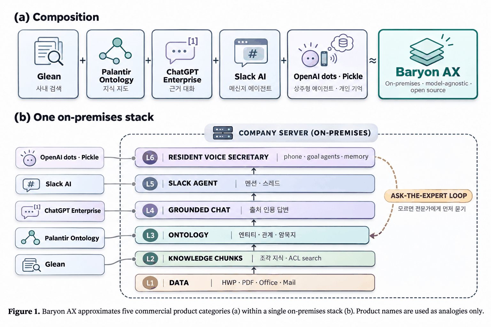</p>

In one picture: roughly Glean + Palantir's ontology + ChatGPT Enterprise + Slack AI + OpenAI dots and Pickle, all running on your own servers.

Start with one line (Docker only, no GPU or API key): see [Quick start](#quick-start). The English website is at [baryon-ax.baryon.ai/en](https://baryon-ax.baryon.ai/en/).

## 라이선스

**소스 공개 멀티 라이선스**입니다. 개인·10인 미만 조직·30일 도입 검토는 [Baryon AX Community License 1.0](LICENSE)으로 무료이고, **10인 이상 조직의 운영 사용과 호스팅 제공은 상용 라이선스**가 필요합니다(도입 상담: martin@baryon.ai). v0.7.0 이하 릴리스는 계속 [MIT](LICENSE.MIT-legacy)입니다. 자세한 기준은 [docs/licensing.md](docs/licensing.md)를 보세요.

© 2026 Baryon Labs. 사용한 외부 오픈소스 구성 요소와 라이선스는 [docs/open-source.md](docs/open-source.md)와 [홈페이지](https://baryon-ax.baryon.ai/open-source/)에 있습니다.
