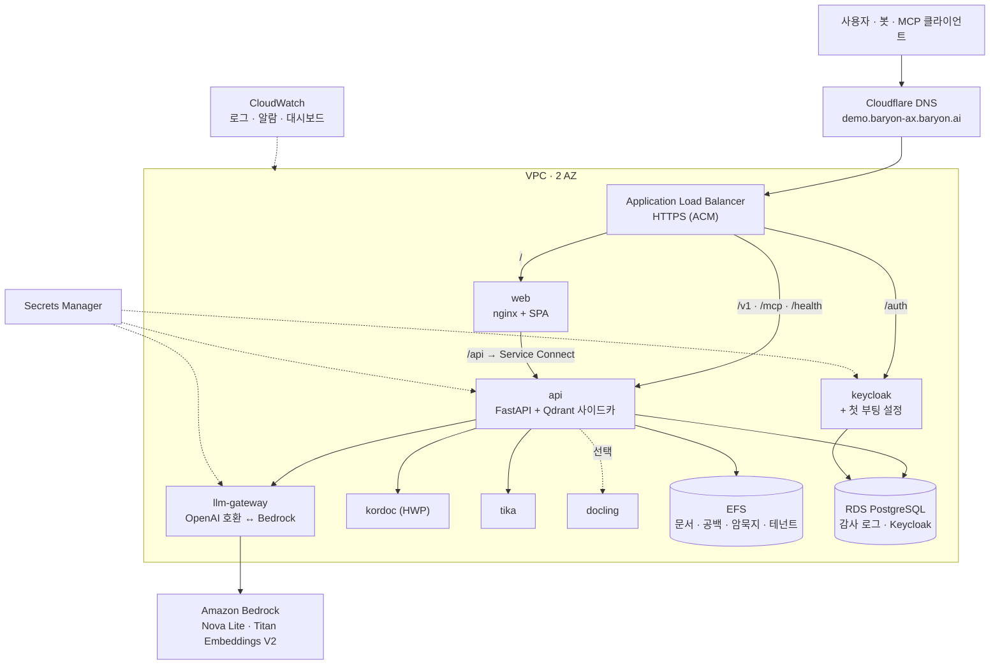

# AWS 배포 — 데모 · 공유(멀티테넌트) · 고객 전용

> 상태: Terraform · 이미지 · 배포 워크플로 준비 완료, **실제 배포는 계정 준비 후** 진행
> 리전: `ap-northeast-2`(서울) · 모델: Amazon Bedrock · DNS: Cloudflare
> 관련: [multi-tenancy.md](multi-tenancy.md) · [auth-oidc.md](auth-oidc.md) · [roadmap.md](roadmap.md)

같은 Terraform 모듈 하나로 세 가지를 만듭니다.

| 환경 | 용도 | 테넌트 | 위치 |
| --- | --- | --- | --- |
| **demo** | 공개 데모, 요청 시 고객사를 테넌트로 추가하는 공유 인스턴스 | `TENANCY_MODE=pooled` | `deploy/aws/terraform/envs/demo` |
| **고객 전용(silo)** | 보안 요구가 큰 고객의 전용 스택(전용 DB · 파일 · 네트워크) | `TENANCY_MODE=single` | `envs/silo-template` 복사 |
| bootstrap | 계정당 한 번: 상태 저장소, ECR, GitHub 배포 역할 | — | `deploy/aws/terraform/bootstrap` |

---

## 1. 구성



| 서비스 | 하는 일 | 크기 |
| --- | --- | --- |
| `web` | SPA와 `/api/*` 프록시(빌드 시 환경별 OIDC 설정을 넣음) | 0.25 vCPU · 0.5 GB |
| `api` | Baryon AX API. Qdrant는 같은 태스크의 사이드카로 두고, 시작할 때 EFS의 문서로 색인을 다시 만듭니다. | 1 vCPU · 3 GB · 임시 디스크 30 GB |
| `llm-gateway` | OpenAI 호환 `/v1/chat/completions` · `/v1/embeddings`를 Bedrock Converse · InvokeModel로 바꿉니다. **이 태스크 역할만** Bedrock을 부를 수 있고, 설정한 두 모델로 제한됩니다. | 0.25 vCPU · 0.5 GB |
| `keycloak` | OIDC. 사이드카가 첫 부팅 때 realm · 클라이언트 · 사용자를 만듭니다. | 1 vCPU · 2 GB |
| `kordoc` · `tika` | HWP/HWPX · 기타 형식 파서 | 각 0.5 vCPU · 2 GB |
| `docling` | PDF · Office · 이미지 레이아웃(선택, 고객 전용에서 기본 켬) | 2 vCPU · 8 GB |

**설계 원칙**

- **관리형 우선:** ECS Fargate · RDS · EFS · Secrets Manager · Bedrock. 서버 패치와 SSH가 없습니다. 디버깅은 ECS Exec로 합니다.
- **장기 키 없음:** Bedrock은 태스크 역할로, GitHub 배포는 OIDC 역할로 접근합니다. DB · 게이트웨이 · Keycloak 비밀은 Terraform이 생성해 Secrets Manager에 둡니다.
- **데이터 계층 분리:** 데이터베이스와 파일 시스템은 삭제 보호, 7일 백업(RDS), AWS Backup(EFS)을 켭니다.
- **API는 한 개 태스크:** 문서 · 공백 · 테넌트 저장소가 EFS의 JSON 파일이라, 배포 때도 옛 태스크를 먼저 멈추고 새 태스크를 띄웁니다(수십 초 중단). 여러 태스크로 늘리려면 저장소와 사용량 카운터를 PostgreSQL · Redis로 옮겨야 합니다([multi-tenancy.md](multi-tenancy.md) 한계 참고).

### 데모와 고객 전용의 차이

| 항목 | demo | 고객 전용 |
| --- | --- | --- |
| 네트워크 | 퍼블릭 서브넷 + 보안 그룹(로드밸런서에서만 접근), NAT 없음 | `private_networking = true`: 프라이빗 서브넷 + NAT, 공인 IP 없음 |
| 운영 시간 | 평일 08~21시(KST)만 실행(`business_hours_only`) | 24시간 |
| DB | 단일 AZ | Multi-AZ |
| docling | 끔(PDF · Office는 Tika로 텍스트 추출) | 켬 |
| 접근 제한 | 전체 공개 | `allowed_cidrs`로 사내망 · VPN만 허용 가능 |
| 이미지 | 움직이는 태그 가능 | 릴리스 태그 고정(`v0.7.0` 등) |

---

## 2. 예상 비용 (서울, 월)

AWS 공개 요금 기준 **추정치**입니다. 배포 전에 [AWS Pricing Calculator](https://calculator.aws/)로 확인하세요. Bedrock은 쓴 만큼 과금되며, 데모 규모에서는 Nova Lite · Titan 임베딩 비용이 몇 달러 수준입니다.

| 항목 | demo (평일 업무시간) | demo (24시간) | 고객 전용 |
| --- | ---: | ---: | ---: |
| Fargate (web · api · gateway · keycloak · kordoc · tika) | 약 $60 | 약 $160 | 약 $160 |
| docling | — | — | 약 $100 |
| Application Load Balancer | 약 $22 | 약 $22 | 약 $22 |
| RDS PostgreSQL t4g.micro (+20 GB) | 약 $21 | 약 $21 | 약 $42 (Multi-AZ) |
| NAT 게이트웨이 | — | — | 약 $45 + 전송량 |
| 공인 IPv4 · EFS · Secrets · CloudWatch | 약 $25 | 약 $45 | 약 $20 |
| **합계(Bedrock 제외)** | **약 $130** | **약 $250** | **약 $390** |

예산 알림은 `monthly_budget_usd`(demo 250, 고객 전용 800)를 넘을 것으로 예상되면 `alert_email`로 갑니다. 비용 태그 `baryon-ax-env`를 Billing에서 **비용 할당 태그로 활성화**해야 환경별 예산이 동작합니다.

---

## 3. 처음 배포하기

### 준비물

- AWS 계정과 관리자 권한(SSO 등으로 `aws sts get-caller-identity`가 되는 상태)
- Terraform 1.5 이상, Docker(buildx), AWS CLI v2
- Cloudflare에서 `baryon.ai` DNS를 수정할 수 있는 권한
- Bedrock 콘솔에서 사용할 모델(기본: Amazon Nova Lite, Titan Text Embeddings V2)의 **서울 리전 사용 가능 여부와 모델 액세스**를 확인합니다. 다른 모델을 쓰려면 `bedrock_chat_model` · `bedrock_embedding_model` · `embedding_dimension`을 바꿉니다.

### 단계

```bash
# 1) 계정 공용 자원 (한 번)
cd deploy/aws/terraform/bootstrap
terraform init && terraform apply
terraform output   # image_registry, state_bucket, lock_table, deploy_role_arn

# 2) 이미지 빌드 · 푸시
cd ../../../..
export IMAGE_REGISTRY=<image_registry 출력값>
deploy/aws/scripts/build_and_push.sh demo demo.baryon-ax.baryon.ai v0.7.0

# 3) demo 환경 — 1차 적용(HTTPS 제외)
cd deploy/aws/terraform/envs/demo
cp backend.hcl.example backend.hcl            # <ACCOUNT_ID> 채우기
cp terraform.tfvars.example terraform.tfvars  # image_registry, image_tag=v0.7.0, alert_email
terraform init -backend-config=backend.hcl
terraform apply
terraform output cloudflare_dns_records
```

4) **Cloudflare:** 출력된 ACM 검증 CNAME을 추가합니다(프록시 끔, DNS only). ACM 콘솔에서 인증서가 `발급됨`이 될 때까지 기다립니다.

```bash
# 5) 2차 적용 — HTTPS 리스너와 경로 규칙
terraform apply -var certificate_validated=true
```

6) **Cloudflare:** `demo.baryon-ax.baryon.ai` → 로드밸런서 DNS 이름 CNAME을 추가합니다(DNS only).

7) **첫 로그인과 데모 테넌트 등록:** pooled 모드에서는 등록된 테넌트의 사용자만 쓸 수 있습니다.

```bash
# 초기 비밀번호 (첫 로그인 때 바꾸게 됩니다)
aws secretsmanager get-secret-value --secret-id baryon-ax-demo/initial-user-passwords \
  --query SecretString --output text

# 플랫폼 관리자로 기기 로그인 → 데모 테넌트 등록
export BARYON_API_URL=https://demo.baryon-ax.baryon.ai
export BARYON_TOKEN=$(deploy/aws/scripts/device_login.sh "$BARYON_API_URL")
python3 scripts/tenant_admin.py create demo "Baryon AX 데모" --plan demo \
  --max-documents 500 --chat-per-day 300 --tokens-per-month 3000000
```

8) `https://demo.baryon-ax.baryon.ai`에서 `demo-admin`으로 로그인해 문서를 올리고 질문해 봅니다.

### 이후 배포

GitHub 환경 `aws-demo`를 만들고 변수 `AWS_DEPLOY_ROLE_ARN` · `AWS_IMAGE_REGISTRY` · `AWS_DOMAIN`을 넣은 뒤, Actions → **deploy to AWS**를 실행합니다. 이미지를 빌드 · 푸시하고 ECS 서비스를 다시 띄웁니다. 인프라 변경은 언제나 `terraform apply`로 합니다.

---

## 4. 고객 제공

### 공유 인스턴스에 테넌트 추가 (요청 당일)

1. 플랫폼 관리자가 테넌트를 만듭니다: `python3 scripts/tenant_admin.py create acme "Acme" --plan standard ...`
2. Keycloak에서 고객 관리자 계정을 만들고 사용자 속성 `organization=acme`, 그룹 `baryon-admin`을 줍니다. 관리 콘솔(`/auth/admin`)은 `admin_cidrs`에 등록된 IP에서만 열립니다.
3. 고객 관리자에게 주소와 초기 비밀번호를 전달합니다. 이후 사용자는 고객 관리자가 요청하면 같은 방식으로 추가합니다.
4. 사용량은 `tenant_admin.py usage acme`, 감사 기록은 `tenant_admin.py audit acme`로 봅니다. 한도는 `update`로 바꿉니다.
5. 종료: `suspend` → 데이터 반환 → `delete --yes`(모든 데이터 삭제, 감사 기록은 보존).

**격리 범위:** 문서 · 벡터 · 공백 · 암묵지 · 팩 · 피드백 · 메모리 · 감사 로그는 조직 단위로 나뉘고, 교차 접근은 테스트로 막혀 있습니다(`apps/api/tests/test_tenant_isolation.py`). 컴퓨팅 · 모델 게이트웨이 · DB 인스턴스는 공유합니다. 사용자는 자기 `organization` 속성을 바꿀 수 없습니다(Keycloak 사용자 프로필에서 관리자 전용으로 선언).

### 고객 전용 스택 (보안 요구가 큰 고객)

```bash
cp -r deploy/aws/terraform/envs/silo-template deploy/aws/terraform/envs/acme
cd deploy/aws/terraform/envs/acme
# terraform.tfvars: customer, domain_name, image_tag(고정), alert_email, admin_users, allowed_cidrs
# backend.hcl: key = "envs/acme/terraform.tfstate"
deploy/aws/scripts/build_and_push.sh acme acme.baryon-ax.baryon.ai v0.7.0   # web 이미지는 환경별
terraform init -backend-config=backend.hcl && terraform apply   # 이후 HTTPS 2단계는 demo와 같음
```

가능하면 고객별 **별도 AWS 계정**에 배포합니다(AWS Organizations). 고객 IdP(Entra ID · Okta)는 Keycloak의 Identity Provider로 연결하면 고객 계정으로 로그인합니다.

---

## 5. 운영

| 할 일 | 방법 |
| --- | --- |
| 로그 | CloudWatch 로그 그룹 `/baryon-ax/<env>/<service>` (30일 보관) |
| 상태 | CloudWatch 대시보드 `baryon-ax-<env>`, 알람(5xx · 비정상 대상 · DB CPU · DB 저장공간)은 `alert_email`로 |
| 컨테이너 접속 | `aws ecs execute-command --cluster baryon-ax-<env> --task <id> --container api --interactive --command sh` |
| 롤백 | 이전 태그로 `terraform apply -var image_tag=<tag>` 또는 배포 워크플로 재실행. 배포 실패 시 ECS 서킷 브레이커가 자동으로 되돌립니다. |
| 백업 | RDS 자동 백업 7일, EFS는 AWS Backup 기본 정책. 복구는 새 인스턴스 · 파일 시스템으로 복원 후 Terraform 값 교체 |
| 비밀 교체 | Secrets Manager 값을 바꾼 뒤 해당 서비스를 다시 배포. DB 비밀번호는 RDS와 비밀을 함께 바꿔야 합니다. |
| 데모 운영 시간 | `business_hours_only`. 시연이 업무시간 밖이면 `aws ecs update-service --desired-count 1`로 잠시 켭니다. |
| Keycloak 관리 콘솔 | `admin_cidrs`에 내 IP를 넣고 적용 → `https://<도메인>/auth/admin` |

---

## 6. 아직 하지 않은 것

| 항목 | 이유 · 시점 |
| --- | --- |
| API 다중 태스크 · 무중단 배포 | 저장소 · 사용량 카운터를 PostgreSQL · Redis로 옮긴 뒤. 고객이 SLA를 요구할 때 |
| WAF · Shield Advanced | 공개 데모 남용이 보이거나 고객이 요구할 때 `aws_wafv2_web_acl`을 ALB에 연결 |
| 계정 보안 기준선(CloudTrail · GuardDuty · Security Hub) | 계정(Organizations) 단위로 한 번 설정. 고객 전용 계정을 만들 때 함께 |
| 고객 관리형 KMS · 비밀 자동 교체 | 고객 보안 심사(SOC2 · ISMS-P 등)에서 요구할 때 |
| 테넌트별 Bedrock 사용량 과금 | 현재는 API의 테넌트 토큰 카운터로 집계. 청구 자동화는 유료 고객 10곳 이후 |
| Qdrant 색인 영속화 | API가 시작할 때마다 문서 전체를 다시 임베딩합니다(데모는 매일 아침). 문서가 수천 건을 넘거나 시작 시간이 길어지면 Qdrant를 EBS 기반 EC2나 관리형 벡터 저장소로 옮깁니다. |
| 다중 리전 | 고객 계약이 요구할 때까지 하지 않음 |

이 문서의 Terraform은 `terraform validate`와 AWS Startup Advisor 정책 검사(ALB TLS · DB 비공개 · 암호화 · 보안 그룹 · IAM 와일드카드)를 통과했습니다. 예외는 bootstrap의 `ecr:GetAuthorizationToken` 하나로, AWS가 리소스 단위 권한을 지원하지 않아 `*`가 필요합니다.
