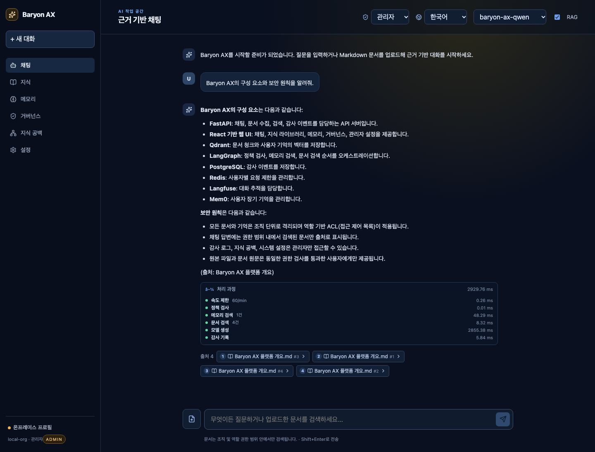
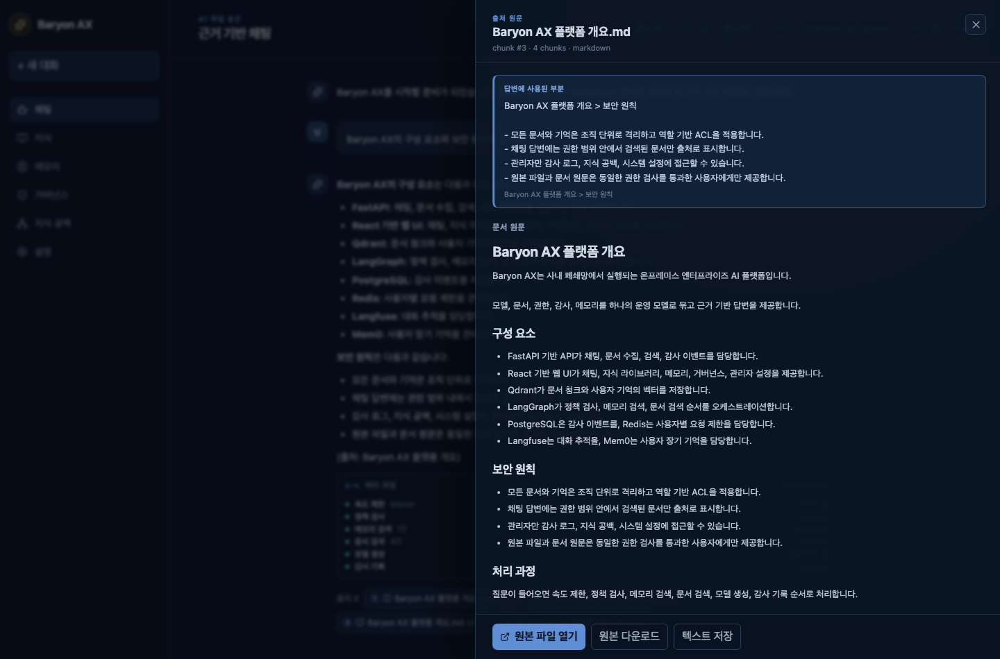
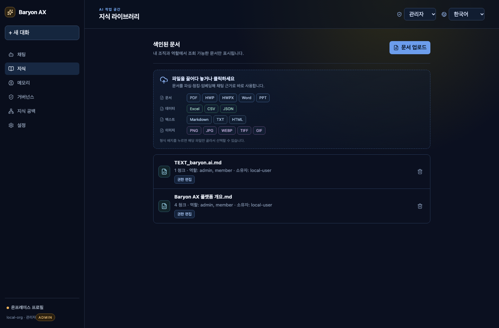
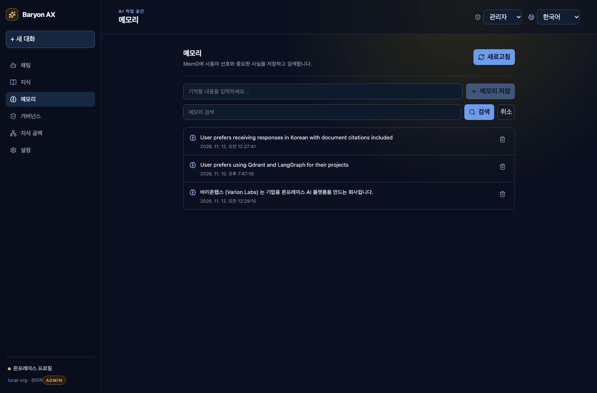
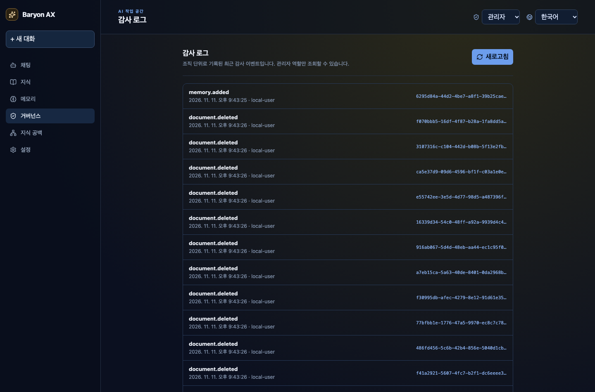
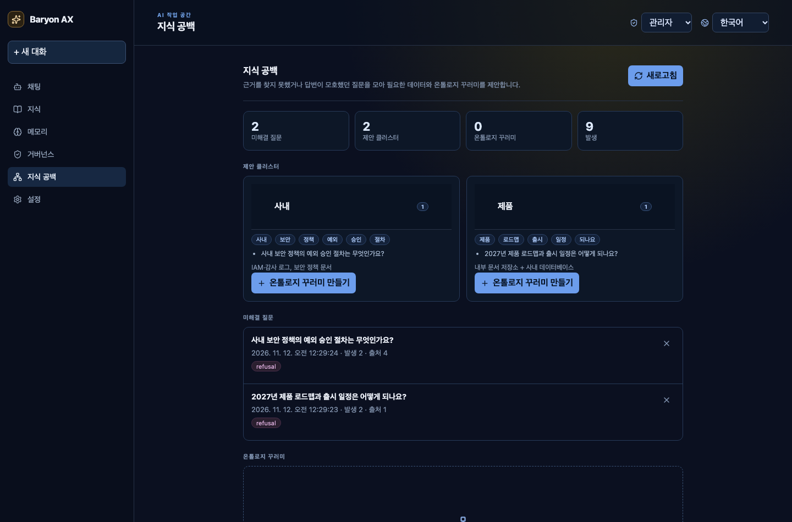
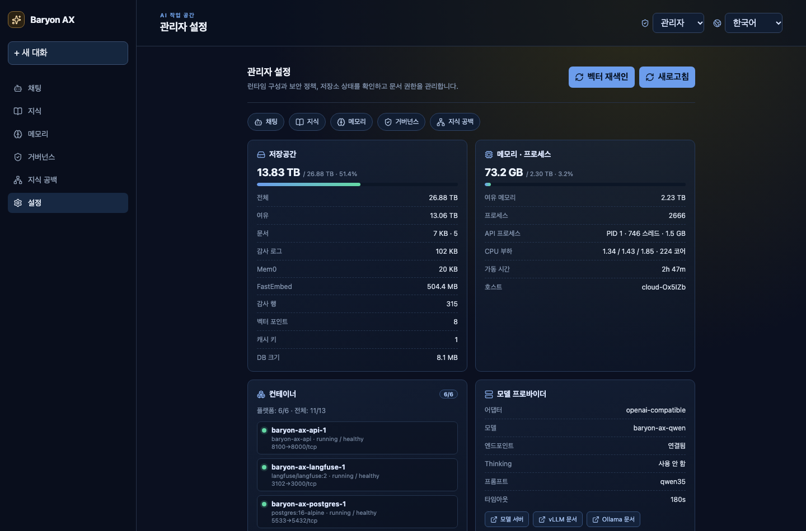

# Baryon AX 화면 갤러리

실제 B300 온프레미스 배포에서 촬영한 화면입니다. Qwen3.5-27B(vLLM), Qdrant, PostgreSQL, Redis, Langfuse, Mem0가 연결된 상태이며, 관리자 역할로 촬영했습니다.

<table>
<tr>
<td width="50%" valign="top">

<h3>1. 근거 기반 채팅</h3>

문서에서 검색한 근거만으로 답변하고, 답변 아래에 <strong>출처 개수와 청크 번호</strong>를 표시합니다. <strong>처리 과정</strong> 패널을 펼치면 속도 제한, 정책 검사, 메모리 검색, 문서 검색, 모델 생성, 감사 기록까지 단계별 소요 시간을 확인할 수 있습니다.

</td>
<td width="50%" valign="top">

<h3>2. 출처 원문 뷰어</h3>

출처를 클릭하면 오른쪽 패널이 열립니다. <strong>답변에 사용된 인용 구절</strong>과 <strong>문서 전체 원문</strong>을 동시에 보여주고, 업로드한 <strong>원본 파일 열기·다운로드</strong>와 텍스트 저장을 제공합니다. 원문과 원본 파일도 조직·역할 ACL을 통과한 사용자에게만 제공됩니다.

</td>
</tr>
<tr>
<td width="50%" valign="top">

<h3>3. 지식 라이브러리</h3>

파일을 끌어다 놓는 것만으로 파싱·청킹·임베딩·색인이 진행됩니다. PDF, HWP, HWPX, Word, PPT, Excel, CSV, JSON, Markdown, 이미지 등 <strong>지원 형식을 배지로 한눈에</strong> 보여주고, 배지를 누르면 해당 형식만 골라서 선택할 수 있습니다. 문서별 청크 수와 허용 역할도 함께 표시됩니다.

</td>
<td width="50%" valign="top">

<h3>4. 사용자 메모리</h3>

Mem0 기반 장기 기억을 저장·검색·삭제합니다. 저장된 기억은 다음 채팅 요청에서 관련도순으로 검색되어 시스템 프롬프트에 주입되므로, 사용자의 선호나 반복 설명을 매번 다시 입력하지 않아도 됩니다.

</td>
</tr>
<tr>
<td width="50%" valign="top">

<h3>5. 거버넌스 · 감사 로그</h3>

채팅 시작·완료, 문서 수집, 권한 변경, 메모리 변경 등 조직의 모든 주요 이벤트를 PostgreSQL에 기록하고 최근 이벤트를 관리자에게 보여줍니다. 각 이벤트에는 추적 ID, 사용자, 모델, 지연 시간이 포함됩니다.

</td>
<td width="50%" valign="top">

<h3>6. 지식 공백 · 온톨로지 제안</h3>

근거를 찾지 못했거나 답변이 모호했던 질문을 자동으로 수집·클러스터링합니다. 어떤 데이터가 부족한지 힌트를 제시하고, 선택한 질문들로 <strong>온톨로지 꾸러미 초안</strong>을 만들어 지식 보강 루프를 닫습니다.

</td>
</tr>
<tr>
<td width="50%" valign="top">

<h3>7. 관리자 설정 · 시스템 상태</h3>

저장공간, 메모리, CPU 부하, 호스트 프로세스 수, Compose 컨테이너 상태, 백엔드 서비스 지표를 실시간으로 보여줍니다. 모델 프로바이더 설정과 Qdrant·Langfuse·vLLM·pgAdmin·Redis Insight 등 <strong>관리자 링크</strong>도 한 화면에서 바로 열 수 있습니다.

</td>
<td width="50%" valign="top">
<h3>촬영 환경</h3>
<ul>
<li>배포: B300 온프레미스 호스트</li>
<li>모델: <code>baryon-ax-qwen</code> (Qwen3.5-27B, vLLM)</li>
<li>검색: Qdrant + FastEmbed</li>
<li>데이터: PostgreSQL, Redis</li>
<li>관측/기억: Langfuse, Mem0</li>
<li>화면: 1440×950, 한국어, 관리자 역할</li>
</ul>

재촬영은 스택이 실행 중인 상태에서 아래 명령으로 수행합니다. 데모 문서와 메모리를 자동으로 준비한 뒤 7장을 갱신합니다.

<pre><code>cd apps/web
E2E_BASE_URL=http://127.0.0.1:3101 \
  node e2e/capture-gallery.mjs</code></pre>
</td>
</tr>
</table>

## 관련 문서

- [기능 전체 목록](features.md)
- [아키텍처](architecture.md)
- [B300 배포 가이드](b300-host-deploy.md)
- [보안 기준](security.md)
