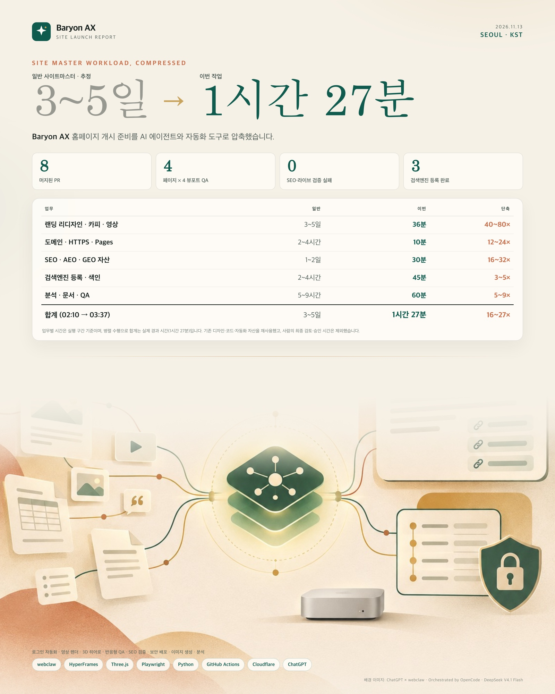

# Baryon AX 사이트 개시 준비 성과 (2026-11-13)

## 요약

- 실제 실행 구간: **2026-11-13 02:10–03:37 KST (약 1시간 27분)**
- 일반 1인 사이트마스터 기준 추정: **3~5영업일 (24~40시간)**
- 체감 단축: **약 16~27배**
- 기존 디자인·코드·SEO 스크립트·검증 도구를 재사용했고, 사람의 최종 검토·승인 시간은 제외했습니다.

## 업무별 비교

| 업무 | 일반 사이트마스터 (추정) | 이번 작업 | 단축 |
|---|---:|---:|---:|
| 랜딩 리디자인·카피·영상 | 3~5일 | 36분 | 40~80× |
| 도메인·HTTPS·Pages | 2~4시간 | 10분 | 12~24× |
| SEO·AEO·GEO 자산 | 1~2일 | 30분 | 16~32× |
| 검색엔진 등록·색인 | 2~4시간 | 45분 | 3~5× |
| 분석·문서·QA | 5~9시간 | 60분 | 5~9× |
| **합계** | **3~5일** | **1시간 27분** | **16~27×** |

> 업무별 시간은 실행 구간 기준이며, 병렬 수행으로 합계는 실제 경과 시간(1시간 27분)입니다.

## 사용한 도구

| 도구 | 역할 |
|---|---|
| **webclaw** | 실제 Chrome 로그인 세션으로 Google Search Console·Naver·Daum·Cloudflare 등록/검증. ChatGPT 이미지 생성 세션도 webclaw로 연결 |
| **HyperFrames** | 6초 1920×1080 무음 루프 영상과 포스터 |
| **Three.js** | 히어로 성좌 캔버스(스크롤·포인터 반응) |
| **Playwright** | 4페이지 × 4뷰포트 반응형 QA, 콘솔 에러·가로 넘침 검사 |
| **Python 검증 스크립트** | `check_site_seo.py`, `check_site_live.py`, 링크·앵커 검사 |
| **GitHub Actions** | `vulnerability sweep`, CI, GitHub Pages 배포 |
| **Cloudflare Web Analytics** | `baryon-ax.baryon.ai` 방문 분석 |
| **OpenCode · DeepSeek V4.1 Flash** | 전체 작업 오케스트레이션과 검증 루프 |

## 이미지 제작

- 배경 일러스트: **ChatGPT (GPT Image) via webclaw** — 텍스트 없는 4:5 배경
- 레이아웃·텍스트: HTML/CSS로 정확한 수치와 도구 설명을 얹고, Playwright로 3200×4000 렌더링 후 1600×2000 JPEG로 변환
- 파일: `docs/images/site-launch-achievement-2026-11-13.jpg`

## 남은 항목

- Daum 검색등록 검토 결과 확인 (신청 완료)
- Bing Webmaster Tools 대시보드 등록 (IndexNow는 완료)
- LinkedIn·Naver 블로그·GitHub 릴리스 홍보 글 발행
