# Voice secretary architecture (UML)

These UML views describe how a spoken request travels from the phone to the secretary and back.
They cover the [app](voice-app.md), [phone gateway](phone.md), [voice secretary](voice-secretary.md)
and [speech sidecar](voice.md). The diagrams are Mermaid, so GitHub renders them.

| View | UML diagram | Question it answers |
| --- | --- | --- |
| [1](#1-use-cases) | Use case | Who uses it, for what |
| [2](#2-components) | Component | Which parts exist and how they connect |
| [3](#3-deployment) | Deployment | What runs where |
| [4](#4-sequence-one-spoken-request) | Sequence | One spoken request, end to end |
| [5](#5-sequence-barge-in) | Sequence | Speaking over the secretary |
| [6](#6-sequence-spoken-confirmation) | Sequence | A side effect waits for a spoken yes |
| [7](#7-sequence-goal-agent) | Sequence | Background work by a goal agent |
| [8](#8-state-machine-call) | State machine | States of a call |
| [9](#9-state-machine-goal) | State machine | Lifecycle of a goal |
| [10](#10-activity-utterance-filter) | Activity | How an utterance becomes a request, or is dropped |
| [11](#11-classes) | Class | Main types in the gateway and the secretary |

## 1. Use cases

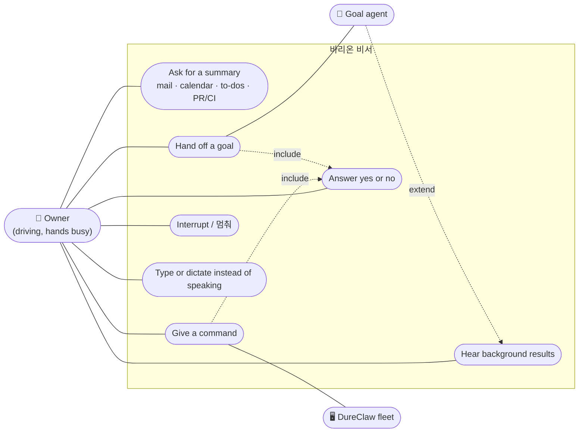

## 2. Components

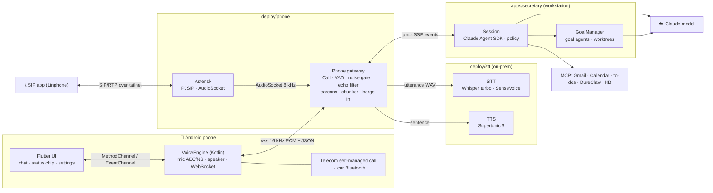

## 3. Deployment

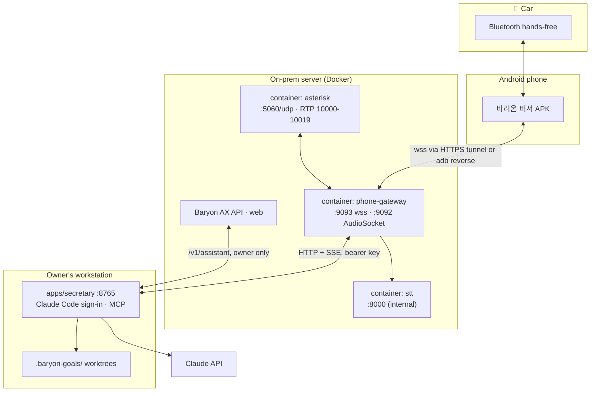

## 4. Sequence: one spoken request

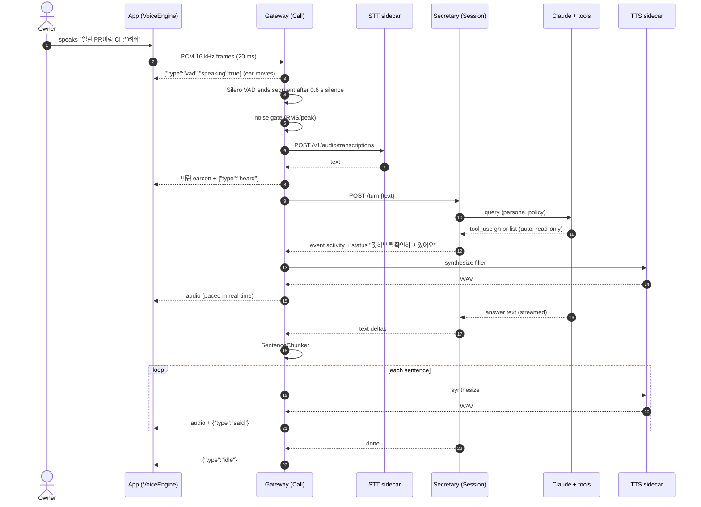

## 5. Sequence: barge-in

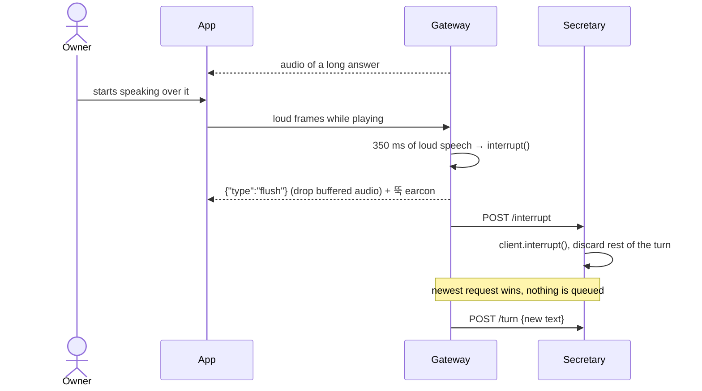

## 6. Sequence: spoken confirmation

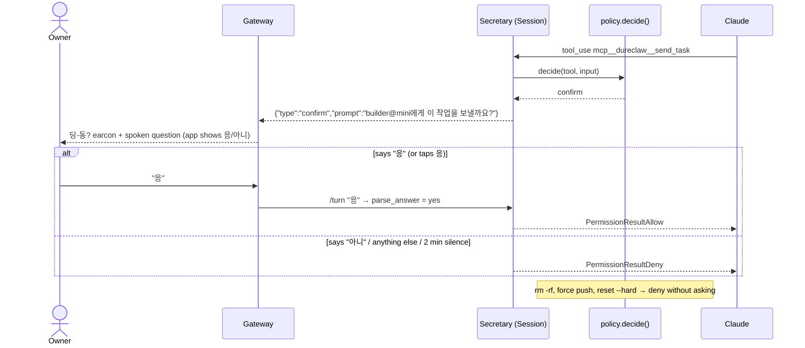

## 7. Sequence: goal agent

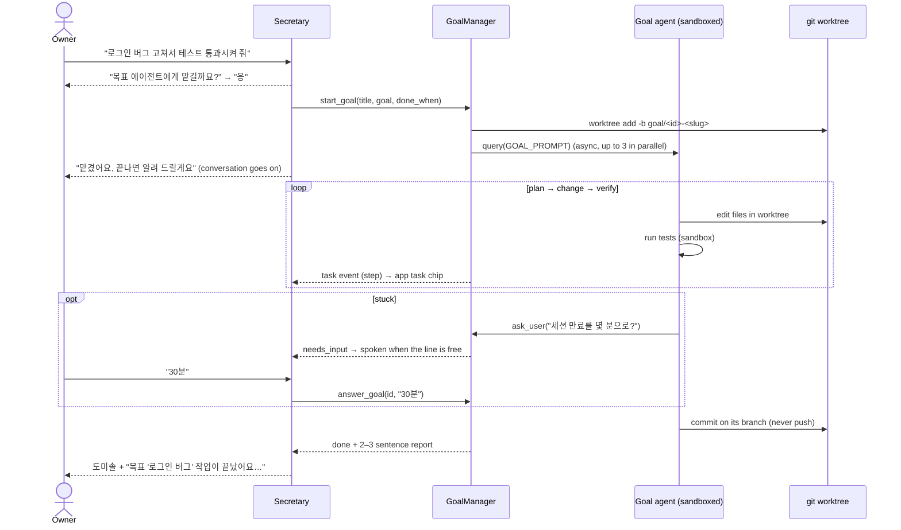

## 8. State machine: call

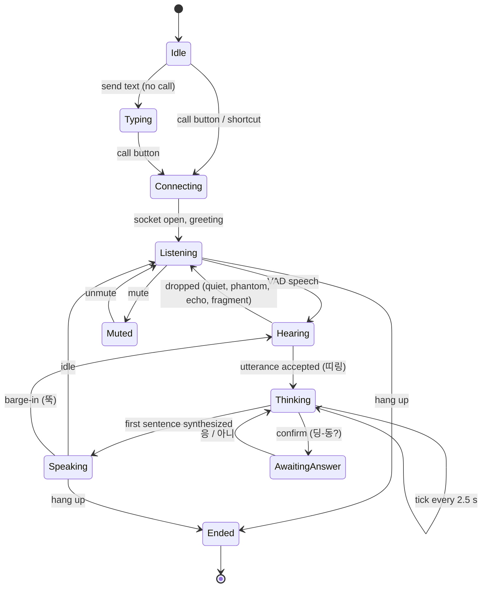

## 9. State machine: goal

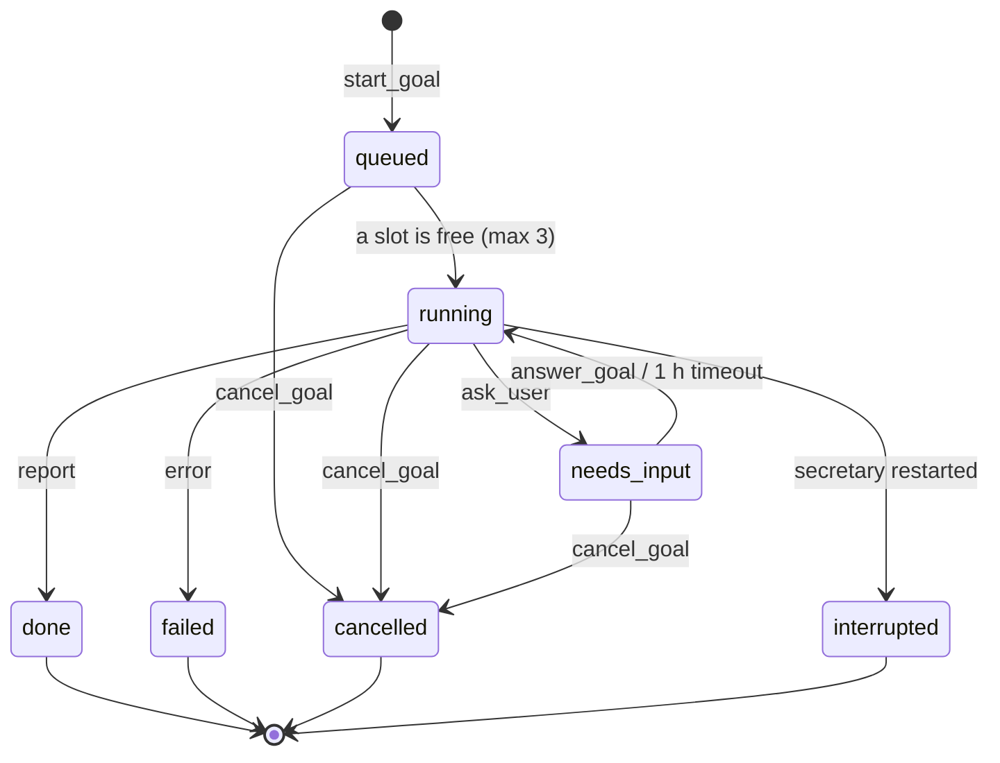

## 10. Activity: utterance filter

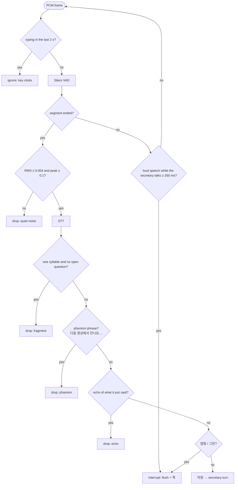

The thresholds come from a real call. Speech had RMS of about 0.015–0.09 and peaks of 0.3–0.9. Room noise that Whisper turned into "다음 영상에서 만나요" stayed under RMS 0.0025 and peak 0.12. Of 97 recorded segments, 78 were dropped before STT, and every real utterance was kept.

## 11. Classes

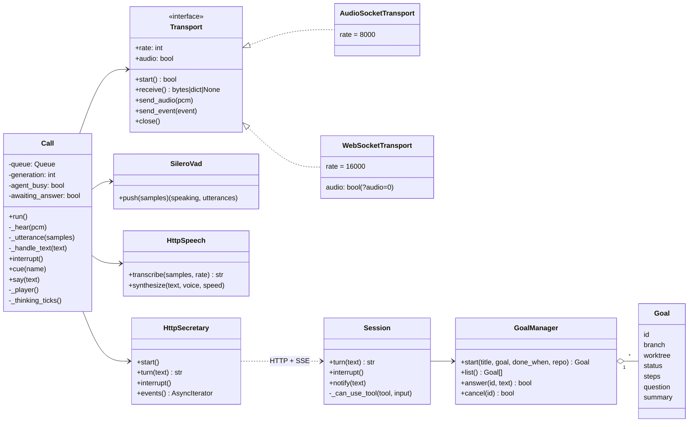
