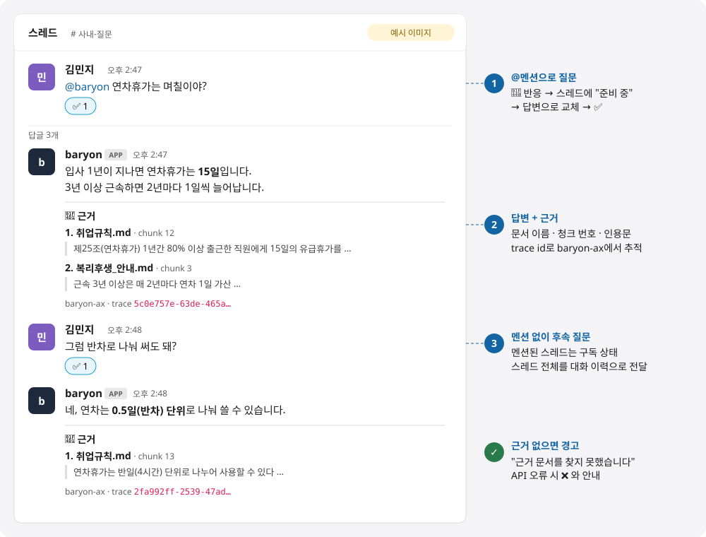

# Slack @멘션 봇 — 근거 + 답변

baryon-ax에 올린 사내 문서를 근거로, Slack에서 `@baryon 질문`에 답하는 확장 예제입니다.
동작 방식은 [CopilotKit/OpenTag](https://github.com/CopilotKit/OpenTag)의 멘션 게이트웨이 패턴을 따르되,
호스팅 서비스 없이 **Socket Mode + baryon-ax API**만으로 동작합니다(공인 IP·터널 불필요).

```
Slack ──(Socket Mode, outbound WS)── baryon_slack_bot.py ──HTTP── baryon-ax API (/v1/chat/completions, /v1/documents/search)
```

## 동작

| 상황 | 봇 동작 |
|---|---|
| 채널에서 `@baryon 질문` | 원문에 👀 → 스레드에 "준비 중" 메시지 → 답변 + **근거**(문서명·청크·인용문) + trace id로 교체 → ✅ |
| 그 스레드에서 멘션 없이 후속 질문 | 구독된 스레드라 바로 답변(OpenTag 방식). 스레드 전체를 대화 이력으로 보내 "그럼 반차는?" 같은 질문도 이어짐 |
| 다른 스레드·채널 일반 메시지 | 무시 |
| 근거 문서 없음 | "근거 문서를 찾지 못했습니다" 경고 표시 |
| API 오류 | 준비 중 메시지를 오류 안내로 바꾸고 ❌ |

사용 예시 (예시 데이터로 그린 화면이며, 실제 스크린샷이 아닙니다):



- Slack 사용자마다 `X-On-Behalf-Of: slack:<USER_ID>`로 요청하므로 감사 로그·지식 공백 기록이 사람별로 남고,
  봇은 `acting_service`로 함께 기록됩니다([인증 — 서비스 계정 위임](#인증--서비스-계정-위임)).
- 문서 열람 권한은 `BARYON_ROLES`(기본 `member`)로 걸러집니다. OIDC 운영에서는 서비스 계정의 역할이 상한입니다.
- 스레드 대화는 `thread_id = slack:<채널>:<스레드 ts>` 로 묶여 baryon-ax 메모리·트레이스와 연결됩니다.

## AI 에이전트로 설치하기 (프롬프트)

Claude Code 같은 코딩 에이전트에게 아래 프롬프트를 그대로 붙여 넣으면 설치부터 Slack 연동 확인까지 진행합니다.
`< >` 부분만 환경에 맞게 바꾸세요. 토큰 발급·앱 설치 승인처럼 계정 권한이 필요한 단계는 에이전트가 사람에게 요청합니다.

````text
baryon-ax 문서 QA를 Slack @멘션 봇으로 연결하려고 한다. 저장소: <baryon-ax 경로>

목표: Slack에서 "@baryon 질문"을 하면 스레드에 답변과 근거(문서·청크·인용문)가 달리고,
같은 스레드에서는 멘션 없이 후속 질문에도 답하게 한다.

1. baryon-ax API 준비
   - API가 <http://127.0.0.1:8000> 에서 동작하는지 /health 로 확인한다. 없으면 README의 Quick start대로 띄운다.
   - LLM은 OpenAI 호환 엔드포인트 <MODEL_BASE_URL>, 모델 <MODEL_NAME> 을 .env에 설정한다.
   - 한국어 문서면 QDRANT_URL을 켜고 RETRIEVAL_MODE=hybrid,
     EMBEDDING_MODEL=intfloat/multilingual-e5-large, EMBEDDING_DIMENSION=1024,
     새 QDRANT_COLLECTION 이름과 QDRANT_REINDEX_ON_START=true(첫 실행만)로 설정한다.
2. 문서 등록
   - <문서 폴더>의 파일을 POST /v1/documents (multipart file, allowed_roles=member,admin) 로 올린다.
   - 파일명은 UTF-8로 보낸다(Windows에서는 curl 대신 Python으로).
   - 정답을 아는 질문 5~10개로 /v1/chat/completions 를 호출해 답과 citations를 확인하고 결과를 표로 보여 준다.
3. Slack 앱
   - examples/slack-bot/manifest.yml 로 앱을 만들거나, 기존 앱 <앱 이름>의 App Manifest에
     같은 bot 권한·event_subscriptions·socket_mode_enabled를 추가한다.
   - App-Level Token(connections:write)을 만들고 앱을 (재)설치한다. 이 두 단계는 나에게 승인을 받는다.
   - 봇을 <채널>에 초대한다.
4. 봇 실행
   - examples/slack-bot 에 venv를 만들고 requirements.txt 를 설치한다.
   - .env.example 을 .env 로 복사해 토큰과 BARYON_API_URL, BARYON_ORGANIZATION_ID, BARYON_ROLES 를 채운다.
   - python -m pytest -q tests 가 통과하는지 확인한 뒤 python baryon_slack_bot.py 를 백그라운드로 실행한다.
5. 연동 확인 (<채널>에서)
   - "@봇 <정답을 아는 질문>" → 👀, 준비 중 메시지, 답변 + 근거 + trace id, ✅ 순서인지 본다.
   - 같은 스레드에서 멘션과 함께 후속 질문 → 앞 대화를 이어받는지 본다.
   - 같은 스레드에서 멘션 없이 질문 → 구독 스레드로 답하는지 본다.
6. 정리
   - 토큰이 든 .env, 조직 전용 설정, 평가 질문과 결과는 저장소 루트 local/ 에 두고 커밋하지 않는다
     (.gitignore에 local/, .env.* 가 있다).
   - 공개 저장소에 올리는 변경에는 조직·과제 이름이나 내부 주소가 들어가지 않게 확인한다.
   - 무엇을 설정했고 어디서 확인했는지, 남은 일을 한국어로 보고한다.
````

## 1. Slack 앱 만들기

1. <https://api.slack.com/apps> → **Create New App → From a manifest** → 워크스페이스 선택 → [`manifest.yml`](manifest.yml) 붙여넣기 → Create.
2. **Basic Information → App-Level Tokens → Generate**: 범위 `connections:write` → `xapp-…` 토큰 = `SLACK_APP_TOKEN`.
3. **Install App → Install to Workspace** → `xoxb-…` 토큰 = `SLACK_BOT_TOKEN`.
4. 쓸 채널에서 `/invite @baryon` (초대하지 않은 채널에서는 Slack이 멘션 이벤트를 보내지 않습니다).

**이미 쓰는 Slack 앱을 재사용**해도 됩니다. 앱 설정의 **App Manifest**에서 위 `bot` 범위와 `event_subscriptions`를
추가하고 `socket_mode_enabled: true`로 저장한 뒤, App-Level Token을 만들고 **Reinstall to Workspace** 하면
기존 `xoxb-` 토큰이 새 범위를 갖게 됩니다.

권한: `app_mentions:read`, `chat:write`는 필수입니다. `channels:history`/`groups:history`가 없으면 스레드 맥락과
멘션 없는 후속 질문만 꺼지고, 멘션 질문은 그대로 동작합니다. `reactions:write`가 없으면 반응만 생략됩니다.

## 2. 실행

```bash
cd examples/slack-bot
python -m venv .venv && . .venv/bin/activate      # Windows: .venv\Scripts\activate
pip install -r requirements.txt
cp .env.example .env                               # 토큰과 BARYON_API_URL 입력
python baryon_slack_bot.py
```

`baryon-ax` API가 먼저 떠 있어야 합니다(`docker compose up` 또는 `uvicorn baryon.main:app`).
검색 품질은 API 쪽 설정을 그대로 따릅니다. 한국어 문서라면 `RETRIEVAL_MODE=hybrid`,
`EMBEDDING_MODEL=intfloat/multilingual-e5-large`(`EMBEDDING_DIMENSION=1024`)를 권장합니다.

## 3. 설정

| 변수 | 기본값 | 설명 |
|---|---|---|
| `SLACK_BOT_TOKEN` / `SLACK_APP_TOKEN` | — | 위 1단계 토큰 |
| `BARYON_API_URL` | `http://127.0.0.1:8000` | baryon-ax API |
| `BARYON_ORGANIZATION_ID` | `local-org` | 문서가 속한 조직 (dev 모드 전용. OIDC에서는 토큰의 조직) |
| `BARYON_ROLES` | `member` | Slack 사용자에게 줄 역할(문서 권한 필터) |
| `BARYON_MODEL` | 서버 기본값 | 모델 지정 |
| `BARYON_OIDC_TOKEN_URL` / `BARYON_OIDC_CLIENT_ID` / `BARYON_OIDC_CLIENT_SECRET` | — | 서비스 계정 client credentials. 넣으면 OIDC 모드 ([인증](#인증--서비스-계정-위임)) |
| `BARYON_API_TOKEN` | — | client credentials 대신 쓸 고정 Bearer 토큰 |
| `SLACK_SUBSCRIBE_THREADS` | `true` | 멘션된 스레드의 후속 질문 자동 응답 |
| `SLACK_THREAD_TURNS` | `10` | 이력으로 보낼 스레드 메시지 수 |
| `SLACK_MAX_SOURCES` | `4` | 표시할 근거 수 |
| `SLACK_SHOW_SNIPPETS` | `true` | 근거 아래 인용문 표시 |

## 인증 — 서비스 계정 위임

봇은 Slack 사용자마다 baryon-ax 토큰을 따로 받지 않습니다. **서비스 계정 하나**로 인증하고, 요청마다 실제 사용자를
`X-On-Behalf-Of`로 알려 줍니다([docs/auth-oidc.md 6절](../../docs/auth-oidc.md#6-서비스-계정-위임봇mcp-클라이언트)).

| 호출 | 보내는 헤더 (`AUTH_MODE=oidc`) |
|---|---|
| Slack 사용자를 위한 호출(질문·근거 검색·답변 저장·등록) | `Authorization: Bearer <서비스 계정 토큰>`, `X-On-Behalf-Of: slack:<USER_ID>`, `X-On-Behalf-Of-Roles: <BARYON_ROLES>` |
| 봇 자신의 호출(먼저 묻기 모드의 공백 조회·닫기) | `Authorization: Bearer <서비스 계정 토큰>`만 |

- 조직은 토큰에서 정해지므로 OIDC 모드에서는 `X-Organization-Id`를 보내지 않습니다(`BARYON_ORGANIZATION_ID`는 dev 모드 전용).
- 토큰은 client credentials로 받습니다. `BARYON_OIDC_TOKEN_URL`·`BARYON_OIDC_CLIENT_ID`·`BARYON_OIDC_CLIENT_SECRET`을 넣으면
  `expires_in`보다 조금 일찍(최대 30초) 새로 받고, API가 401을 주면 새 토큰으로 **한 번만** 다시 시도합니다.
  세 값이 없으면 `BARYON_API_TOKEN`(고정 토큰)을 그대로 보내고, 둘 다 없으면 dev 모드로 동작합니다.
- 서비스 계정은 IdP에서 `baryon-service`(위임 허용)와 `baryon-member` 그룹에 넣습니다.
  먼저 묻기 모드를 켤 때만 `baryon-admin`도 추가하세요(공백 조회·닫기가 관리자 API입니다).
- 위임된 사용자의 역할은 서비스 계정 역할을 넘을 수 없습니다. `BARYON_ROLES`에 서비스 계정에 없는 역할을 넣으면 버려지고,
  남는 역할이 없으면 403입니다.
- API 쪽에서 `OIDC_DELEGATION_USER_PREFIXES=slack:`로 위임 대상 ID를 제한할 수 있습니다.

감사 로그에는 실제 사용자와 봇이 함께 남습니다(`GET /v1/audit-events`).

```json
{"type": "chat.completed", "user_id": "slack:U123ABC", "organization_id": "local-org",
 "acting_service": "service-account-baryon-slack-bot", "trace_id": "..."}
```

dev 모드(`AUTH_MODE=dev`, 토큰 없음)에서는 봇이 자기 신원 `X-User-Id: slack-bot`과 `X-Organization-Id`를 보내고,
사용자를 위한 호출에는 `X-On-Behalf-Of`를 더합니다. API가 이를 운영과 같은 모양(`user_id=slack:<USER_ID>`,
`acting_service=slack-bot`)으로 기록하므로 운영 전에 로컬에서 감사 형태를 확인할 수 있습니다.
봇 자신의 호출은 `X-Roles: <PROACTIVE_SERVICE_ROLES>`(기본 `admin`)로 보냅니다.

## 먼저 묻기 모드 (proactive)

봇이 답하지 못한 질문을 그냥 두지 않고, **사람에게 먼저 물어봐서** 문서로 만드는 모드입니다.
[OpenDots](https://github.com/CopilotKit/OpenDots)의 "예약 실행 + 실행 전 승인" 개념을 baryon-ax의
지식 공백(knowledge gap)·암묵지(tacit) API 위에 얹었습니다. `PROACTIVE_CHANNEL`을 넣으면 켜집니다.

```
질문 → 근거 없음/답 못함 → baryon-ax가 지식 공백으로 기록
   → (정해진 시간마다) 봇이 데스크 채널에 "제가 답하지 못한 질문이 있어요" + [해당 없음]
   → 누군가 스레드에 답 → 그 사람 이름으로 초안 저장 + "문서로 등록할까요?" [문서로 등록] [취소]
   → 작성자가 등록 → 문서로 색인, 공백 해결 → 원래 질문 스레드로 돌아가 질문자를 불러 근거와 함께 다시 답변
```

- 등록은 답을 쓴 사람만 할 수 있습니다(baryon-ax 암묵지 API가 작성자를 확인).
- 이미 물어본 공백은 `PROACTIVE_STATE_PATH` JSON에 남아 재시작해도 다시 묻지 않습니다.
- 버튼을 쓰려면 앱의 **Interactivity**를 켜야 합니다(`manifest.yml`에 반영, Socket Mode라 Request URL 불필요).
- 공백 목록 조회·닫기는 관리자 API라 봇이 자기 신원으로 호출합니다. OIDC에서는 서비스 계정에 `baryon-admin`이 있어야 하고,
  dev 모드에서는 `PROACTIVE_SERVICE_ROLES`(기본 `admin`)를 `X-Roles`로 보냅니다. 답변 저장·등록은 답한 사람으로 위임해 호출합니다.

| 변수 | 기본값 | 설명 |
|---|---|---|
| `PROACTIVE_CHANNEL` | — | 질문을 올릴 데스크 채널 ID. 비우면 꺼짐 |
| `PROACTIVE_INTERVAL_MINUTES` | `30` | 확인 주기 |
| `PROACTIVE_HOURS` / `PROACTIVE_WEEKDAYS_ONLY` | — / `false` | 예: `9-18`, `true` → 평일 근무 시간에만 묻기 |
| `PROACTIVE_MAX_PER_RUN` | `3` | 한 번에 올릴 최대 질문 수 (자주 나온 질문부터) |
| `PROACTIVE_MIN_OCCURRENCES` | `1` | 이 횟수 이상 나온 질문만 |
| `PROACTIVE_SLACK_ONLY` | `false` | Slack에서 나온 질문만 (웹 UI·스크립트에서 생긴 공백 제외) |
| `PROACTIVE_MENTION` | — | 질문 앞에 붙일 멘션. 예: `<!here>`, `<@U123> <@U456>` |
| `PROACTIVE_REANSWER` | `true` | 등록 후 원래 스레드에 다시 답하기 |
| `PROACTIVE_STATE_PATH` | `.data/proactive_state.json` | 물어본 기록 |

## 비서 모드 — 일을 맡기기 (secretary_bridge.py)

기본 봇은 **문서로 답하는 봇**이라 "메일 초안 만들어서 연락까지 해 봐" 같은 **일**은 하지 못합니다. 상주형 음성 비서
([apps/secretary](../../apps/secretary))를 함께 띄워 두면, 비서의 주인이 슬랙에서 맡긴 일은 비서가 처리합니다.

```bash
SECRETARY_URL=http://127.0.0.1:18603      # 음성 비서 서버
SECRETARY_API_KEY=...                     # 비서의 SECRETARY_API_KEY
SECRETARY_SLACK_USERS=U0123ABCD           # 비서를 쓸 수 있는 슬랙 사용자 ID(쉼표로 여러 명). 비서는 이 사람의 메일·일정으로 일합니다
# SECRETARY_ALL=true                      # 이 사용자들의 모든 멘션을 비서로 (기본: 일을 맡기는 말만)
```

- **누가**: `SECRETARY_SLACK_USERS`의 사용자만. 다른 사람의 멘션은 그대로 문서 봇이 답합니다.
- **언제**: 초안, 메일, 보내, 연락, 일정, 예약, 만들어, 작성, 해 봐, 전략, 시나리오 같은 말이 있거나 "비서"로 시작할 때.
  그 스레드는 이후 멘션 없이 답해도 비서가 이어받습니다("제목 바꿔 줘", "응").
- **무엇을**: 링크 읽기, 회사 소개를 근거로 한 협력 제안·전략·연락 시나리오, 메일 초안, 일정, 할 일, 목표 에이전트 등 비서가 하는 일 전부.
  답은 짧은 본문과 카드(제안서, 메일 초안, 표)로 스레드에 올라옵니다.
- **확인**: 메일 보내기·초안 만들기·일정 등록처럼 밖으로 나가거나 바뀌는 일은 **진행 / 취소** 버튼으로 확인한 뒤에만 합니다.
  버튼은 주인만 누를 수 있고, 스레드에 "응"/"아니"로 답해도 됩니다.
- 앱의 **Interactivity**가 켜져 있어야 버튼이 동작합니다(`manifest.yml`에 반영).

예: `@baryon https://www.gonggong.ai/#aroom 이런 업체와 우리가 협력한다면? 제안과 연락 시나리오, 전략을 세워서 메일 초안으로 만들어 줘`

## 4. 테스트

```bash
pip install pytest && python -m pytest -q tests
```

Slack·API 없이 가짜 WebClient와 `httpx.MockTransport`로 멘션 → 준비 중 → 답변/근거 교체, 스레드 이력,
권한 없는 경우의 대체 동작, 구독 스레드 판별, API 오류 처리를 검증합니다. `tests/test_auth.py`는 사용자 위임과 봇 자신의 호출
헤더, OIDC 모드에서 `X-Organization-Id`를 보내지 않는지, 토큰 캐시·만료 전 갱신·401 시 한 번 재발급을 검증합니다.

## 확장 아이디어

- 답변 아래 👍/👎 버튼 → baryon-ax 피드백 API로 연결
- 먼저 묻기 모드에서 질문 주제별로 담당자(채널·사람)를 다르게 지정
- 채널별로 `BARYON_ROLES`/조직을 다르게 매핑(예: 경영지원 채널만 인사 문서 열람)
- 파일 공유 이벤트(`file_shared`)를 받아 `/v1/documents`로 바로 색인

## 조직별 설정과 활용사례

토큰이 담긴 `.env`와 특정 조직·과제의 활용 기록(평가 질문, 채널, 앱 ID 등)은 저장소 루트의 `local/`에 두세요.
`local/`과 `.env.*`(예제 파일 제외)는 `.gitignore`에 들어 있어 커밋되지 않습니다.
